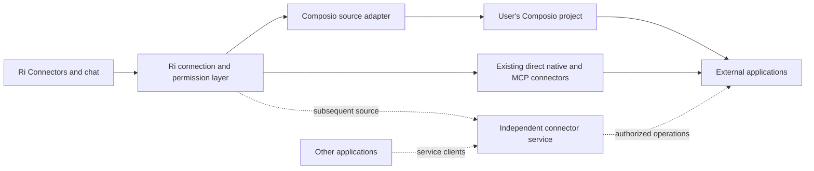

# Connector sources with Composio first

**Status:** Implemented on October 15, 2026 (section 15 maps it to the code). Verified end to end against a local stand-in for Composio's API, in tests and in a browser. Real-account acceptance (section 13 step 1 and the section 14 Gmail and Calendar rows) still needs a Composio project key and two Google test accounts.

**Date:** October 15, 2026.

Ri will support managed connection sources alongside its existing direct connectors. Composio is the first managed source. Users connect their Composio project once, then sign in to supported applications without registering an OAuth app for each one. Ri presents the actual applications and accounts, remembers preferred connection methods, and applies its normal agent permissions and action approvals.

The owner's independent connector service is a subsequent source, with its own backend, database, and developer interface. Building that service or an OAuth broker is not a dependency of the Composio release.

This is the single specification for this initiative. Existing engine, auth-config, approval, and chat-connection specifications remain the contracts for their respective subsystems.

## 1. Product decisions

- Composio is the first managed source. Existing direct native and MCP connections remain supported.
- The initial release uses the user's own Composio project and API key, configured once in Ri. Application sign-in then uses Composio-managed authentication where available.
- Ri does not distribute an operator-owned Composio project key or introduce a centrally funded gateway in this release.
- Source settings and preferences live in a versioned configuration file in the Ri home. Credentials remain in protected secret storage.
- Users may enable multiple sources and choose an overall preference and application-specific overrides.
- A preference chooses how to create a new connection. It does not move accounts, grant permissions, or change the execution backend of an existing connection.
- The application-first experience and permission model apply equally to Composio and the future independent service.
- Success is measured by working user workflows and reliable account handling, not the number of advertised integrations.

One-time Composio setup is a deliberate first-release tradeoff. This removes per-application developer setup, but it is not a promise of zero credentials or zero external account setup. Composio usage is billed under the user's own plan. Ri does not hardcode vendor prices or promise unlimited usage.

## 2. What the user experiences

### Enable Composio once

The user opens **Connectors → Sources → Composio**, or reaches the same panel while connecting an application.

1. Ri explains that Composio will store the connected application's credentials and process calls made through that source.
2. The user supplies their own Composio project API key through a protected input. Ri links to the vendor's setup instructions.
3. Ri validates access on the server, establishes the source identity, and saves the key through protected storage.
4. The first enabled managed source becomes preferred, visibly labeled and easy to change. Enabling another source does not replace that preference.
5. Ri returns to the application or chat that initiated setup.

Use a project dedicated to this Ri home by default. Do not automatically import every account reachable through a project key. Reusing an existing project does not grant its other users' accounts to Ri.

Browser sign-in to an application and authenticating Ri to Composio are separate steps. Do not label a pasted project key as OAuth sign-in or claim a Composio account-login flow that has not been implemented.

### Connect an application

The main journey after source setup is:

**Connectors → Gmail → Connect → browser consent → verify account → choose agent access**

Ri shows one primary method and a small alternative:

> **Connect Gmail**
>
> Using Composio, your preferred source. Composio stores this connection and processes its tool requests.
>
> **Connect** · Change method

The completed account appears as **Gmail · Work**, with its verified address, status, and **via Composio** label. The user's own label supplements the verified identity and never replaces it.

Existing connected accounts appear before offers to add another. Work and personal accounts remain distinct even when they have the same application and source.

The same journey works from a chat's existing `request_connection` card. Connecting an account and allowing the asking agent to use it are explicit decisions. After both finish, the existing chat-resume mechanism reloads the permitted tools and continues.

The agent access picker has one application heading, such as **Gmail**, with accounts grouped by connection method underneath. Each account shows its verified identity and source. Managed accounts have individual checkboxes. Any **Select all connected accounts** control selects only the currently displayed accounts, not future ones. The grouping does not merge permission namespaces.

An application with only direct accounts keeps today's **All accounts** option and wording. Once managed accounts appear under the same heading, that option becomes **All direct accounts, including future direct accounts**, so it cannot be read as covering them. Label the exception, not the common case.

For managed Google sign-in, explain that the consent screen names Composio. Link setup details covering shared provider quotas and available scopes. Composio recommends custom OAuth apps for production branding, scopes, and dedicated quotas, but this is not a blanket prohibition on managed authentication. The release must prove the section 4 workflows with the default managed scopes. Do not silently extend those scopes or require users to register an OAuth app to complete the advertised journey. If managed auth cannot support it, resolve that release blocker explicitly. [Managed and custom authentication](https://docs.composio.dev/docs/authentication/custom-app-vs-managed-app).

### Manage accounts and sources

**Your sources** shows enabled sources, their health, and the preferred marker. Other available sources are less prominent. Within an application's method picker, users can choose another enabled source, a direct connection, or their own credentials.

Changing a preference never asks the user to reconnect working accounts. Disabling a source stops Ri from using it and explains which accounts depend on it. It does not silently revoke all accounts in the user's external project.

The UI distinguishes:

- **Remove agent access:** only the selected agent loses access.
- **Disconnect from Ri:** stop using the selected local connection and explain whether any remote connection remains.
- **Revoke remote access:** an explicit operation against that exact remote account, with its wider effect stated.

Do not report successful provider revocation when only local access was removed.

## 3. Connection-method selection

Application identity, source identity, auth config, and account identity are separate concepts. Gmail is an application. A user's Composio project is a source instance. An auth config describes authorization. Work Gmail is an account connected through a particular route.

For a new connection:

1. Use an explicitly selected application method if it supports the required capability.
2. Otherwise use the overall preferred source if it supports that capability.
3. With no applicable preference, recommend a working direct route first, then another enabled managed source. Unconfigured services come after enabled ones.
4. If a saved preference is disabled, unavailable, or lacks the capability, explain why and offer the next suitable method. The user chooses before new authorization begins.

An explicit **Change method** selection becomes that application's override. Merely accepting an automatically recommended method does not create an override that would defeat a later overall preference change.

Changing the overall preference preserves explicit application overrides. Removing an override restores the overall rule. Recent activity does not silently reorder preferences.

Once connected, execution always uses that connection's bound source and account. An outage, missing capability, or denied permission never causes account or source failover.

Availability is capability-specific. A source that can read calendar events might not support creating them or feeding Ri's Calendar view. Display relevant limitations before connection, and do not offer a method for a feature it cannot support.

## 4. First-release coverage

Ship the source infrastructure and one complete Composio adapter. Validate these initial agent workflows:

| Application | Required workflow |
| --- | --- |
| Gmail | Find messages and read the selected message or thread |
| Gmail | Create a draft and send a user-approved message from the selected account |
| Google Calendar | List events in a requested date range |
| Google Calendar | Create a user-approved event in the selected calendar |

Each workflow must work with two accounts and with agent access restricted to only one. Sending and event creation use controlled test accounts during verification.

The adapter discovers schemas and executes tools generically. Adding an application should require catalog mapping, capability and risk review, and real-account acceptance rather than a new integration path through Ri. Do not present every vendor-listed toolkit as tested or available automatically.

The initial supported catalog is Gmail and Google Calendar through Composio, alongside today's direct catalog. Additional Composio applications use the same adapter and become available after the same acceptance process.

### Calendar view and deck

Google Calendar through Composio also feeds Ri's Calendar view, `get_day_shape`, and deck in this release. A user who connects a calendar should not need a second connection to make the product see it.

Add a typed read adapter at the shared [calendar service](../src/lib/calendar/service.ts), reusing its existing normalized calendar and event contracts. Support calendar discovery and the same selected-calendar rules as direct Google, bounded pagination, time zones, all-day and recurring events, and declined or free-marked events. Preserve account and source provenance. When the same event arrives through direct and managed routes, merge verified copies for display and busy-time calculation without merging account grants.

During connection, make use by Ri's Calendar and deck visible and controllable. This authorizes the app's specific calendar reads, independently of agent access. Background reads use an app actor and exact account binding, with live source and connection checks. Removing agent access alone does not disable a calendar the user enabled for Ri. Disabling that product use stops its background reads and invalidates its cache.

Carry unavailable and partial-read status through the [deck adapter](../src/lib/deck/calendar-integration.ts). Preserve known busy blocks and identify unknown availability. An outage or unreadable response must not become a confirmed empty calendar or an assertion that the whole day is free. Deck generation can continue with that limitation visible.

Other typed consumers, including the task picker, retain their established contracts. Additional managed applications become eligible for those features only when a corresponding typed adapter is implemented and tested. Setup explains feature-specific limitations before connection.

## 5. Architecture



Ri's home is the trusted host. The browser and model do not receive a source credential, an unrestricted vendor session, or a callable gateway that bypasses Ri's enforcement.

The source adapter handles discovery, connection lifecycle, account metadata, tool schemas, and execution. It feeds the existing integration engine's action pipeline. It does not create a second approval system.

| Responsibility | Existing foundation |
| --- | --- |
| Provider, toolkit, connection, action, and error contracts | [Engine types](../packages/integrations/src/core/types.ts) and [errors](../packages/integrations/src/core/errors.ts) |
| Runtime and protected connection storage | [Ri runtime](../src/lib/integrations/runtime.ts) and [file store](../packages/integrations/src/store/file.ts) |
| Host-owned authentication for an exact account | `Provider.externalAuth.forConnection` in [engine types](../packages/integrations/src/core/types.ts) |
| Account-bound external actions and schema handling | [MCP ingestion](../packages/integrations/src/mcp/ingest.ts) |
| Agent account filtering | [Workspace filter](../src/lib/integrations/workspace-filter.ts) and [scope pins](../src/lib/integrations/scope-pins.ts) |
| User approval policy | [Approval specification](integration-approvals.md) |
| Connection requests and chat continuation | [Connection requests](../src/lib/integrations/connection-requests.ts) and [chat connection specification](connecting-from-chat.md) |
| Configuration paths and atomic writes | [Integration storage](../src/lib/integrations/storage.ts) and [atomic file helpers](../src/lib/config/atomic-file.ts) |

Reuse these boundaries where they fit. Do not force Composio into a raw MCP-server URL if that hides downstream accounts or action identities. Extend shared external-action registration where necessary.

Keep vendor API shapes inside the adapter. The common contract covers listing applications and capabilities, starting and verifying authorization, listing bound accounts, inspecting health, reconnecting, disconnecting, fetching tool definitions, and executing one concrete action. Keep vendor-specific features explicit rather than inventing identical semantics across all sources.

Internal UI calls use tRPC and shared domain operations. OAuth callbacks and external protocols retain HTTP endpoints. Server registries and work-in-flight state use `processState`. Secrets, identity checks, and execution remain server-side.

## 6. Configuration and credentials

Use `<config-dir>/integrations/preferences.json`, resolved through `getIntegrationsDir()`. It holds safe source metadata and preferences. The following illustrates the version 1 shape:

```json
{
  "version": 1,
  "sources": [
    {
      "id": "source_01",
      "kind": "composio",
      "label": "Composio",
      "enabled": true,
      "remoteUserId": "ri_user_01"
    }
  ],
  "preferredSourceId": "source_01",
  "applicationMethods": {
    "gmail": {
      "sourceId": "source_01"
    }
  }
}
```

Source IDs and remote user IDs are generated opaque values, immutable after creation. Examples above are placeholders. The file can represent several instances of a source kind, such as separate personal and work projects.

A managed method has the shape `{ "sourceId": "source_01" }`. A direct method has the shape `{ "kind": "direct", "providerId": "google", "authConfigId": "user-google" }`, with `authConfigId` optional. Validation accepts exactly one shape. Direct connections are always available through the existing catalog and do not require a fake managed source entry. Do not repurpose `authConfigId` as a source identifier.

Persist a verified project binding when the vendor exposes one. Source credentials are stored separately, sealed using the integration secret-storage boundary and keyed by source ID. Account references remain in connection storage. This file contains no API keys, tokens, session URLs, or client secrets.

Requirements:

- Missing file means no saved source preferences and preserves today's direct behavior.
- Validate input and file contents. Reject unsupported versions without rewriting them.
- A malformed file is reported and preserved. Do not silently reset it or broaden access.
- Writes are atomic and serialized with the existing cross-process file lock. Read the current revision under the lock before applying a partial mutation.
- Validate source and method references before use. Stale preferences are displayed as unavailable until changed.
- Preferences belong to the Ri home. Every device viewing that home sees the same choices. A separate home has separate settings.
- Keep source provisioning recoverable across the config and secret stores. An entry without a valid credential is incomplete and cannot execute. Never publish credentials in configuration events or API responses.
- Key rotation preserves identity only after verifying it still accesses the same source project and bound accounts. Otherwise create a new source instance and require explicit account selection.
- Disabling or removing a source invalidates its cached runtimes and sessions. Never reuse a removed source ID.

The preference file itself requires no SQLite migration. Source metadata and backward-compatible connection extensions should use existing storage where appropriate. If correct account or permission representation requires a database change, use an ordinary forward migration. Avoiding a migration is not a reason to overload identity fields.

No reset, automatic credential transfer, or forced reconnect is required for existing direct connections.

## 7. Identity and agent permissions

The local owner sentinel is not a globally unique external user ID. Generate and persist a stable Composio user ID per source instance and Ri owner. Reuse it for authorization, account discovery, and execution. Do not derive it from an email address or allow the model to choose it.

This release assumes one Ri owner per home. Future team homes need a separate external user binding per member and explicit shared-account grants. Never reuse the single-owner binding as implicit access for every member.

A managed account binding identifies:

- The Ri owner and immutable source instance.
- The remote user and remote connected-account ID.
- The remote toolkit and auth config where relevant.
- The provider-side account identity, verified when available.
- Its local connection ID and health.

A managed connection's `accountId` is the Composio connected-account ID. Keep verified email and provider identity as metadata, not the permission key. The enclosing managed namespace supplies source isolation, and `authConfigId` retains its real auth-config identity. The local connection ID remains Ri's record ID.

Use `Provider.externalAuth.forConnection` for host-owned authentication and exact-account transport selection. It already excludes native token access and fallback to another connection. Extend the stored credential/reference representation as needed for an explicit managed reference. The hook does not mean the current credential union already supports one. A remote account reference is not an OAuth token, and must not be disguised as a bearer token. Its current-binding check must reject replaced or removed bindings, including changes made by another process.

Namespace managed provider, toolkit, and action identities by source instance and remote identity. Application aliases such as Gmail group them in the UI. Existing native action IDs and toolkit IDs stay unchanged. Two routes to the same email address are distinct connections.

Preserve legacy account pins and fail-closed resolution. New managed agent grants contain explicit accounts. Do not generate an unbounded account grant when enabling a source or finishing consent.

The existing [scope schema](../src/lib/db/schema.ts) treats an omitted account list as all accounts, including future accounts. Preserve that behavior within existing direct toolkit namespaces. A newly added managed source must have a distinct namespace, so it cannot enter those old grants implicitly. Do not introduce an **All future accounts** option for managed sources in this release.

When a new remote connected-account ID replaces an old one, require an explicit rebind and grant confirmation. Email equality alone is insufficient to transfer permissions. A reconnect that preserves the remote binding can preserve its existing grants after verification.

Catalog updates do not grant new capabilities automatically. New actions pass the supported-catalog review and existing approval policy. Changed schemas invalidate incompatible cached tools and pending approvals.

## 8. Composio connection lifecycle

Call Composio's REST API v3.1 through Ri's own small typed client. Do not bundle the Composio SDK. Ri is open source and local-first, and every install would otherwise carry vendor code, its telemetry and version checks, and retry and default behavior that the rules below must override. The client sends every session restriction explicitly, validates every response it reads, keeps only the fields it needs, and never retries a mutation. Composio's current model uses stable user IDs, hosted Connect Links, and managed token storage and refresh. Ri retains account references instead of retrieving provider OAuth tokens. [Authentication](https://docs.composio.dev/docs/authentication), [token custody](https://docs.composio.dev/docs/security/token-custody), [session configuration](https://docs.composio.dev/docs/configuring-sessions).

### Authorization

1. Resolve the source, application, requested capability, and configured authentication method on the server.
2. Store a bounded, single-use connection attempt bound to the Ri owner, source, remote user, toolkit, initiating chat where applicable, and allowed return destination.
3. Ask Composio for a Connect Link through its supported authorization API.
4. Open the link in the user's browser. No agent-visible API key or unrestricted source session is involved.
5. Verify completion through Composio, checking the returned account against the stored attempt and expected user, source, and toolkit.
6. Read verified account metadata, save the local reference idempotently, and present agent access choices.

Callback query parameters and a success redirect are not proof of ownership. Composio documents server-side verification of the connection attempt and authenticated user. [Manual authentication](https://docs.composio.dev/docs/authentication/manually-authenticating).

Use the existing home callback and desktop return mechanisms where supported. Bounded server-side status polling can finish the same stored attempt when a browser redirect cannot reach the home. Verify the flow from the host, a phone viewing the home, and the desktop app.

An abandoned, expired, mismatched, or replayed attempt creates no grant. Restart recovery must reuse or reconcile the recorded attempt rather than start duplicate authorizations.

The vendor controls Connect Link expiry. Bound the local attempt by the link response's required `expires_at` and any shorter local timeout. Generate a fresh link when it expires. A polling timeout is not proof that authorization failed, so reconcile the existing attempt before offering another. [Connected accounts and link expiry](https://docs.composio.dev/kb/guide/platform-connected-accounts).

### Discovery and reconnect

Discover only accounts belonging to the bound remote user. Require explicit selection before importing an existing account or granting it to an agent. Project-key access to other remote users is not authorization to expose their accounts.

The first release creates a dedicated remote user for each source binding. Accounts already present under that binding can be reused. Accounts belonging to another remote user in the same project require fresh authorization for Ri. Do not imply that supplying a project key automatically imports an existing Composio setup.

Use explicit multi-account authorization for **Add another account**. Display verified identity separately from aliases. Account discovery and reconnection never select the newest account as an implicit replacement.

Composio owns token refresh. Ri maps actual expired or revoked account state to reconnect, while source-key failures, quotas, and transient outages remain separate. It does not implement a parallel provider refresh loop.

### Disconnect and revocation

Block new local calls immediately when access is removed, and invalidate affected sessions and pending approvals. Remote cleanup can be retried independently.

Composio distinguishes disabling, revoking, and deleting an account, and upstream revocation may be unsupported or fail. Choose the operation matching the user's stated scope and report partial cleanup accurately. Never delete an entire remote user or project as part of disconnecting one account. [Connected-account API](https://docs.composio.dev/reference/api-reference/connected-accounts).

## 9. Tool discovery and sessions

Use Composio's current session API for agent tools behind the adapter. Preloading tools is incompatible with session multi-account mode. Use a separate session for each selected account, with `multi_account.enable: false` and an explicit `connected_accounts` binding. Two Gmail accounts therefore use two sessions. [Session configuration](https://docs.composio.dev/docs/configuring-sessions).

Ri controls discovery and projects only the permitted, supported actions into its existing harness tool surface. Search may be generic, but execution must resolve to one concrete action and account before authorization or approval.

Per-account sessions are an execution detail, not a tool shape. Project one tool per action for each source instance, with the existing `account` parameter choosing among that route's granted accounts, as direct multi-account tools do today. The adapter routes each call to the selected account's session. Two Gmail accounts never produce two copies of the same tool.

### Session construction and lifecycle

Create sessions privately, apply restrictions, then read back the server configuration and concrete tool list before registering them with Ri. Required TypeScript settings are:

| Stage | Settings |
| --- | --- |
| Create | Positive `toolkits.enable` and per-toolkit `tools.enable` allowlists, exact `connected_accounts`, `preload.tools` naming exactly the allowed slugs, `multi_account.enable: false`, `workbench.enable: false`, `proxy_execute.enable: false`, `manage_connections` with `enable`, `enable_wait_for_connections` and `enable_connection_removal` all false, `search.enable: false`, `execute.enable_multi_execute: false`, `instant: false` |
| Execute | `enable_auto_workbench_offload: false`, so a large result is returned rather than moved into a workbench file |

The REST create call accepts every switch, so a session is complete when it is created. The SDK applies some of these only on update, which is one more reason Ri does not use it. Set `instant: false` because omitting it enables Composio's paid instant tools. Set `proxy_execute` explicitly even though omitting it leaves `COMPOSIO_PROXY_EXECUTE` off, because that helper sends arbitrary authenticated requests to the provider API and is the broadest executor a session can expose. Reject unexpected tools, including any `COMPOSIO_*` helper. Never publish a partially configured session. On failure, deny local use and clean up the vendor session. [Configuration switches](https://docs.composio.dev/docs/configuring-sessions).

Additional requirements:

- With no allowed actions, create no session and invalidate/delete any existing one. Never substitute `null`, omitted restrictions, or an empty denylist for denial.
- Key a session by its source, remote user, exact account, and allowed-action set with its policy revision. Callers whose grants for that account are identical can share it, because the harness never holds the session and Ri checks the live caller before every call. A chat is part of Ri's authorization and audit, not of the vendor session. Never reuse a session across owners, accounts, or different action sets.
- Create a session on the first call that needs it, not when a chat starts. A chat that never uses an account costs no vendor session.
- Keep session IDs and MCP URLs server-side. Never hand the harness a vendor URL that bypasses Ri.
- Recheck live Ri access before every call. Invalidate local use immediately on permission changes, then construct a replacement session through the same validation sequence. Delete obsolete sessions. Do not rely on partial map updates to preserve restrictions.
- Persist enough server-only lifecycle metadata to clean up orphaned sessions after restart. Failed remote cleanup cannot restore local access.

Composio sessions otherwise resolve newly connected accounts dynamically. Explicit account overrides prevent fallback to another account. Its sessions also persist until deleted, so Ri must manage their lifecycle. [Session restrictions and lifecycle](https://docs.composio.dev/kb/guide/mcp-tool-router-sessions).

If the REST API cannot constrain a required operation this way, that operation is unavailable until the adapter can enforce the contract. Do not substitute a broad generic executor.

### Tool versions and typed reads

Session tools follow the latest published version and cannot be version-pinned. Ri records the reported version and a canonical schema hash with the discovered action and any approval. Refresh definitions before dispatch, revalidate arguments, and invalidate approval on a detected version or schema change. Fetch definitions for the session's latest version rather than the older default of the v3 tools endpoint. [Session tool versions](https://docs.composio.dev/docs/configuring-sessions).

This check detects observed changes but is not an atomic vendor-side version lock. Do not promise that it prevents a vendor release between validation and execution. If an action requires that stronger guarantee, execute its approved dated version through the explicit versioned path below or leave it unavailable.

The typed Calendar read adapter, and the identity read that verifies a newly connected account, use Composio's supported version-pinned direct-execution API as a narrow exception to session execution. Pin a tested dated toolkit version, explicitly select the remote account and user, allow only the required calendar reads, and validate the output before normalization. This path goes through the same Ri source, account, and app-permission checks. It is not an unrestricted tool exposed to the model. Version-pinned approved actions, if needed, must additionally pass the same approval pipeline.

Composio labels this API legacy but continues to support it, and recommends dated versions for programmatically consumed outputs. Treat this dependency as an intentional adapter tradeoff. Track deprecation, test upgrades, and report a retired version as unavailable rather than silently falling back to latest. [Direct execution](https://docs.composio.dev/docs/tools-direct/executing-tools), [versioning and retirement](https://docs.composio.dev/docs/tools-direct/toolkit-versioning).

## 10. Execution and approval

Every managed action follows this sequence:

1. Resolve the calling Ri actor and its live permissions.
2. Resolve an enabled source and an exact local-to-remote account binding.
3. Resolve a supported concrete action and validate arguments against its current schema.
4. Apply existing tool enablement and approval policy to the real action.
5. If approval is needed, show the actual account, meaningful action details, and relevant arguments.
6. Recheck permission, the approved arguments, and the tool definition immediately before dispatch, subject to the session version limits in section 9.
7. Execute through the constrained Composio session, or the explicitly versioned path in section 9, and return a normalized outcome.

The model cannot supply arbitrary source credentials, remote user IDs, sessions, or accounts outside the allowed set. A request such as **Send this message from Work Gmail** must retain that identity through approval, execution, and audit.

Classify action risk through reviewed catalog metadata and existing policy. Unknown semantics cannot become an automatically approved read merely because a vendor calls something a tool. One approval for a generic executor does not authorize arbitrary downstream writes.

Ri enforces human approval. Composio enforces its project and session constraints. A user's own project key is intentionally broad, so Ri's server enforcement is essential. The future independent service will similarly enforce client grants without needing to verify Ri's approval-card UI.

## 11. Reliability and data handling

Map vendor failures into the existing engine taxonomy and structured outcomes:

| Condition | Required behavior |
| --- | --- |
| Expired or revoked connected account | Reconnect that exact account |
| Invalid source key or source disabled | Repair or enable the source, preserving account references |
| Rate limit or quota exhausted | Explain the source limit and respect retry timing |
| Temporary outage or timeout | Preserve connections and permissions |
| Missing or changed tool | Refresh supported capabilities, then revalidate |
| Denied account or tool | Stop without fallback |
| Write may have reached the provider | Mark the outcome uncertain and reconcile before any retry |

Reads may use bounded retries. Disable automatic mutation retries in the adapter and transport unless the particular operation has a verified idempotency contract. Cancellation after dispatch does not prove a write was cancelled. Persist enough operation identity to investigate an uncertain outcome without recording secrets.

Record a local operation ID before dispatch, then save the returned Composio `log_id` when available. Composio does not provide execution deduplication. A log ID helps investigation, but may never reach Ri if the response is lost and is not proof of the provider's final state. Reconcile through available execution logs and provider-side evidence, such as the created message or event. If evidence is inconclusive, keep the outcome uncertain and explain it before any explicit user-directed retry. [Production retry guidance](https://docs.composio.dev/docs/production-readiness).

Creating an authorization attempt and saving its result are idempotent local operations. Replaying a completed callback cannot create duplicate accounts or duplicate grants.

The project API key is sealed at rest, redacted from every sink, and used only by the home server. Source sessions and raw account responses receive the same scrutiny. Never include credentials in model context, client responses, audit records, logs, or error messages.

Composio holds managed account credentials and processes tool inputs and outputs. Do not promise that its processing or retention matches Ri's local behavior. Show custody before consent and link current vendor information. Existing direct connections retain their current data flow. Chat results may also reach the configured model service.

Audit the source, exact account reference, action, schema revision, approval decision, timing, and outcome using Ri's existing mechanisms. Avoid adding raw mail content to operational logs. Treat tool results and vendor descriptions as untrusted data.

## 12. Future independent service

The owner plans to operate a separate connector service. Its final name is undecided. It will be another source in Ri and usable by external applications through its own API and MCP surface.

It owns its backend, database and migrations, customer/project identities, end-user bindings, client grants, credential protection, and operations. It may reuse Beamd sign-in and billing through service-specific credentials. Its database does not become part of Ri's database, and its API must not depend on Ri chat or workspace records.

Share connector definitions and runtime behavior where appropriate. Ri's onboarding can be especially smooth because both codebases are owned, while the underlying public contract and permission checks remain the same as for other clients.

Two implementation modes remain available:

| Mode | Purpose and constraints |
| --- | --- |
| Managed execution | The service holds account credentials and executes tools. Validate it through Ri and a small independent client before expanding the catalog. |
| Authorization broker | The service assists authorization and refresh while the client retains account tokens and runs tools. Add it only where provider rules and a useful workflow justify it. |

Prefer local execution when capabilities and reliability are equivalent, subject to the user's chosen source. Do not restrict managed execution solely because some local tools exist for the same application.

Broker mode is not a prerequisite of this release or a requirement for every future provider. Validate client type, callback behavior, and token handling with each provider. Google requires appropriate client registration, and Microsoft cautions against forwarding tokens from confidential to public clients. [Google OAuth policy](https://developers.google.com/identity/protocols/oauth2/policies), [Microsoft client guidance](https://learn.microsoft.com/en-us/entra/identity-platform/msal-client-applications).

A future broker's refresh recovery must state its limits. A response cache can recover delivery failure after persistence, but cannot guarantee recovery when a provider rotates a token before the broker durably receives it. Any encrypted retry storage must be disclosed accurately, with request binding, expiry, and reconnect behavior.

If Ri later funds a shared Composio project, keep its key in an authenticated hosted gateway with tenant isolation and scoped client access. That is a separate offering from the user-owned-project release. Do not move existing Composio accounts into the new service automatically.

Service pricing, branding, licensing, and the exact approved OAuth deployment are future product decisions. They do not block the Composio adapter. Approval for one application does not imply permission for every external developer's use.

Prepare the independent service's provider registrations and approval requirements alongside Composio implementation. Establish the service identity, domains, data flow, and minimum scopes early, then start verification and any required assessment when the provider's prerequisites are met. This work may require a functioning consent flow or demonstration. It is not assumed to be paperwork that can be completed before any code exists, and it is not a release dependency for user-owned Composio projects.

## 13. Implementation sequence

1. **Adapter proof:** build the typed REST client, establish the stable remote user, complete managed Google authorization, and demonstrate reads and approved writes with two accounts in the same toolkit. Prove per-account sessions, restriction readback, rejection of unintended helpers, version-change handling, and session cleanup. Also prove the pinned Calendar read contract with default managed scopes.
2. **Source configuration:** implement the versioned file, protected credentials, source health, deterministic preference selection, and source-instance identity.
3. **Account and tool integration:** register distinct managed accounts and actions through the engine, enforce explicit grants, and integrate connection and approval cards.
4. **Complete lifecycle and product use:** add multiple accounts, reconnect, key rotation, disabling, scoped removal, remote cleanup, session invalidation, and uncertain-write handling. Connect the typed Calendar read adapter to Calendar and the deck, including app access controls and partial-read handling.
5. **Validate and release:** complete Gmail and Calendar acceptance across Settings, chat, Calendar, and the deck, preserve direct behavior, and publish accurate user-facing setup guidance.
6. **Subsequent sources:** add the independent service or another platform through the same contract. Prove the independent service with an external client before broadening its catalog.

The adapter proof is a release gate, not permission to leave the shipped implementation as a prototype. All first-release acceptance criteria below must pass.

## 14. Acceptance criteria

| Area | Required evidence |
| --- | --- |
| Source setup | A user configures their Composio project once, then connects supported apps without supplying per-app OAuth credentials |
| Preferences | Overall and explicit application preferences persist across restarts and devices viewing the same home |
| Multiple sources | A second source instance does not replace the preference, merge accounts, or inherit grants |
| Method selection | Unsupported preferences produce an explanation and an offered alternative before consent, with no execution failover |
| Configuration safety | Missing file preserves direct behavior, malformed/unsupported files are preserved, concurrent writes do not lose changes, and no secrets appear in the file |
| Authorization | Forged, mismatched, expired, and replayed callbacks cannot attach another user's account or create a grant |
| Account isolation | Work and personal accounts, two source instances, and direct versus Composio accounts remain separate |
| Existing grants | Legacy direct all-account grants do not acquire managed accounts, and new managed grants name explicit accounts |
| Access picker | One application grouping shows source-labeled accounts. Direct-only applications keep **All accounts**, and mixed groups use wording that distinguishes future direct accounts from currently selected managed accounts |
| Live revocation | Removing access blocks the next dispatch, including through a cached session or a pending approval |
| Tool control | Hidden actions, unknown schemas, generic executors, batches, and sandboxes cannot bypass account, tool, or approval restrictions |
| Approvals | The displayed account and action match execution, and changes to arguments, account, or an observed tool version/schema invalidate the approval. Session checks do not claim atomic version pinning |
| Gmail and Calendar | Every workflow in section 4 completes against controlled real accounts, including multi-account cases |
| Product calendars | Composio calendars feed Calendar, day shape, and deck with correct times and busy blocks. Duplicate routes do not duplicate events, and incomplete reads remain visibly incomplete |
| App versus agent access | Calendar product access and agent grants can be removed independently, and neither silently creates the other |
| Lifecycle | Account expiry, source-key expiry, key rotation, disconnect, partial remote cleanup, and interrupted authorization produce distinct useful outcomes |
| Reliability | Rate limits and outages preserve connections, and an uncertain write is never automatically duplicated |
| Session lifecycle | Two accounts in one toolkit work through separately bound sessions behind one tool set. Callers with identical grants share a session, and chats that never use an account create none. Partially configured sessions, unexpected helpers, proxy execution, empty grants, and newly added ungranted accounts cannot execute. Access changes and restart cleanup invalidate obsolete sessions |
| Typed tool versions | Calendar reads use a tested pinned version and validate responses. Schema errors and retired versions produce unavailable data, without a silent switch to latest |
| Secret confinement | Sentinel credentials never reach browser read responses, model tools, errors, logs, or audit output |
| Compatibility | Existing direct connections, auth configs, public action IDs, typed product consumers, and chat continuation keep working |
| Entry points | Setup and connection work from Settings and chat on the host browser, a phone viewing the home, and the desktop app |

Test pure preference and identity logic, adapter contracts, authorization and execution boundaries, and the user journeys above. Reuse the repository's existing test patterns. Run relevant tests, typechecking, and lint for the eventual implementation, and use the dev home for real-account verification.

Release only the capabilities demonstrated by those checks. Keep the shared source contract extensible, while the product remains a simple list of applications and accounts.

## 15. Implementation map

Everything lives under `src/lib/integrations/sources/` unless named otherwise.

| Spec | Code |
| --- | --- |
| §2 Sources panel, application pages, method picker, agent access step | `src/components/settings/sections/integrations/sources-panel.tsx`, `application-detail.tsx`, wired in `integrations-section.tsx` (anchors `integrations:sources`, `integrations:app:<id>`) |
| §2 Access picker grouping and the "All direct accounts" rule | `src/components/workspaces/integration-scope-picker.tsx` |
| §2 Chat cards (connect through a source, managed reconnect) | `src/components/executions/connection-request-card.tsx`, `startCardManagedSignIn`, `resolveCardWithManagedConnection` and `managedAlternative` in `src/lib/integrations/connection-requests.ts` |
| §3 Method selection | `method-selection.ts` (pure), `connectionMethod` in `service.ts` |
| §4 Reviewed catalog, pinned typed-read versions | `composio/catalog.ts` |
| §4 Calendar view, day shape and deck | `calendar-reads.ts`, `src/lib/calendar/service.ts` (managed route, `complete`, `partial`, `via`), `src/lib/deck/calendar.ts` (`readCalendarDay` availability), `get_day_shape` |
| §5 Engine integration | `managed-provider.ts` (one source-namespaced provider per application, `externalAuth.forConnection`), registered in `src/lib/integrations/runtime.ts` |
| §6 Preferences file and sealed credentials | `preferences.ts`, `source-credentials.ts`, `types.ts` |
| §7 Identity and bindings | `managed-connections.ts` (`accountId` is the remote connected-account id), the `remote_account` credential in `packages/integrations/src/core/types.ts` and `packages/integrations/src/auth/remote.ts`. Named-account grants: `validateIntegrationScopes` in `src/lib/integrations/scopes.ts` and `resolveIntegrationFilter` in `src/lib/integrations/workspace-filter.ts` |
| §8 Lifecycle | `service.ts` (add, rotate, disable, remove, connect, reconnect, import, disconnect, revoke), `attempts.ts`, `composio/adapter.ts`, `src/app/api/integrations/managed/callback/route.ts` |
| §9 Sessions | `composio/sessions.ts` (restriction readback, shared registry, orphan cleanup), `composio/client.ts` (`sessionCreateBody`) |
| §10 and §11 Execution, errors, uncertain writes, audit | `managed-provider.ts` (`toIntegrationError`), `audit.ts`, `revokeApprovalsForConnections` in `src/lib/integrations/approval.ts` |
| REST client | `composio/client.ts` |
| Typed procedures | `router.ts`, mounted as `integrationSources` |
| Tests | `*.test.ts` beside each module, `managed.e2e.test.ts`, `calendar.e2e.test.ts`, managed cases in `src/lib/integrations/connection-requests.test.ts`, the fake API in `composio/fake-composio.ts` |
| Trying it without a project | `scripts/dev-fake-composio.ts` (docs/environments.md) |

Decisions made while building, beyond the text above:

- The callback and polling paths finish the same stored attempt. An attempt records the remote account its link created, so completion is checked against exactly that account, and a repeated Connect reuses a pending link instead of starting another consent. Concurrent starts for the same sign-in (two clicks, two tabs) share one link.
- Completing a sign-in, cancelling it, disconnecting and importing each take the account's turn for their final check and write (`withAccountTurn` in `service.ts`). Completion rechecks the attempt, the source and, for a reconnect, the row in that turn, so a cancel or disconnect that lands while consent is being verified always wins.
- A managed toolkit is only ever granted on named accounts. The server refuses an unbounded grant for one, and a stored scope without accounts grants nothing.
- A session's tool must match the definition Ri registered: the same version and the same structure (`schemaShapeHash` in `composio/sessions.ts`: fields, types, requirements and constraints, with titles, descriptions and examples left out). Wording or key-order differences between the project and session listings are not a change.
- Right before dispatch, a call rechecks that its source is usable and its account still active and bound. Every invalidation bumps an epoch for the source or account, and a session set up across one is deleted instead of used or published.
- The client's deadline and the caller's cancel cover the whole exchange, including the response body. A body cut off after a write's headers is reported as possibly applied.
- A calendar the user shows in Ri that can't be read now (it needs a reconnect, or its source is off) stays in the range as a failed read, so its time is unknown rather than free. A calendar list that can't be read in full, or is cut short by the page bound, marks the account partial.
- The chat card shows the Calendar use choice for Google Calendar, polls a managed reconnect like a new connect, and records "Change method" to the direct route as the application's override when the person connects that way, with a way back to the source.
- `instant: false` and `enable_auto_workbench_offload: false` are part of every session and execution, alongside the switches in §9.
- Development's auto-approval is recorded as `dev_auto` in the audit trail, never as a human grant.
