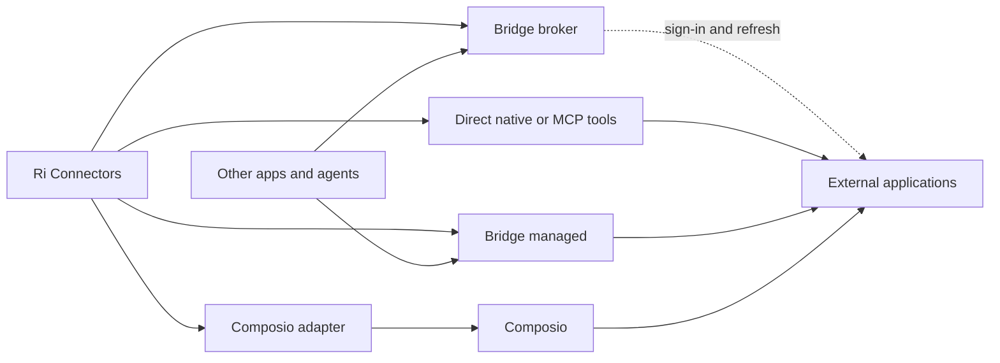
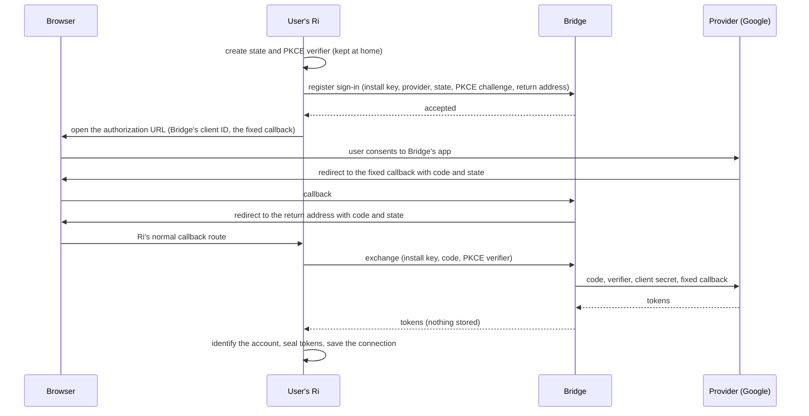

# Connector service: connect accounts for Ri and other apps

**Status:** Final proposal. Nothing here is built. **Date:** October 15, 2026.

**Supersedes** the Ri Connect spec (this file's earlier name, `ri-connect-spec.md`) and [Independent connector platform and Ri integration](integrations-managed-connections-proposal.md). It combines the October 15 planning chat, both documents and their reviews of each other. Outside facts were checked against provider documentation on October 15, 2026 (Sources, at the end).

It builds on the [integrations module spec](integrations-module-spec.md) (§15 prior art, §20 hosted mode), the [auth config spec](integrations-authconfig-spec.md), the [desktop callback relay](desktop.md#hosted-https-callback-relay) and the [beamd hosted auth spec](beamd-hosted-auth-spec.md).

**Name.** The service's name is undecided. This spec calls it **Bridge**, from Trey's "use the Ri connector, bridge or whatever". Renaming it is a find-and-replace before any code exists.

## Summary

Ri users shouldn't have to bring their own keys to connect Gmail or Slack. What they're missing is an OAuth app the provider has already approved, and that approval is what Composio and similar platforms sell. Trey wants to own that business rather than resell it.

1. **Bridge is a connector service Trey operates, independent of Ri.** It has its own brand, database, dashboard and developer interface. Ri is its first client, and other developers' apps can use it too.
2. **It has two modes.** In **broker mode**, Bridge holds only its OAuth apps' secrets and helps with sign-in and refresh. Account tokens stay in the user's Ri, and calls go straight to Gmail. In **managed mode**, Bridge holds the account tokens and runs the tools itself, which is what a developer without a Ri home needs.
3. **Inside Ri, Bridge keeps at home whatever Ri can do at home.** Ri uses broker mode for every app it has tools for, and managed mode only for apps it doesn't. A Ri user's mail never passes through Bridge.
4. **Ri remembers how each user likes to connect.** Bridge, Composio, a direct connection and the user's own OAuth app are all sources. The user's chosen sources are remembered, one primary **Connect** button uses the preferred one, and **Change method** keeps the rest in reach.
5. **Delivery is staged.** Provider approvals start now, because they gate everything. Broker mode ships first, since it's the smallest piece and it removes setup from Ri's 13 hardest connectors. Managed mode and the developer interface come next, proven by a second client that isn't Ri. Composio is an optional source that can arrive at any point.
6. **Ri users pay through the beamd account**, alongside remote access. Developer pricing is set from measured costs. Bringing your own OAuth app stays free.

Decisions already made and those still open are in §16.

## 1. Terms

| Term | Meaning |
| --- | --- |
| Application | The thing a user connects, such as Gmail. |
| Source | Who supplies the connection: Bridge, Composio, a direct connection, or the user's own OAuth app. |
| Account | One connected account, such as Work Gmail. One application can have several accounts, from different sources. |
| Mode | How Bridge serves a connection: broker or managed (§3.2). |
| OAuth app (client) | An app registered with a provider. Users see its name on the consent screen. |
| Client ID / client secret | The app's public identifier, and its password. The secret turns sign-in codes into tokens and refreshes them, so it can't ship in an open-source download. |
| Confidential client / public client | An app that keeps a secret on a server, or one that has no secret and proves itself with a PKCE verifier. |
| Callback address | Where the provider sends the browser after consent. It must exactly match an address registered with the app. |
| Authorization code | The short-lived, single-use code returned through the browser and exchanged for tokens. |
| PKCE verifier | A one-time value created at the start of sign-in, without which the code can't be exchanged. |
| Access token / refresh token | The short-lived token each call carries, usually for an hour, and the long-lived token that gets new ones. |
| Verification / review | A provider's approval of an app for public use. For Gmail, Google also requires a yearly security assessment (CASA). |

## 2. The problem

Of Ri's [69 connectors](integrations-current.md), here is what each asks of the user:

| What the user must bring | Count | Connectors |
| --- | --- | --- |
| Nothing but a browser sign-in (or no account at all) | 46 | Notion, Linear, Atlassian, Airtable, ClickUp, Todoist, Stripe, Figma and the rest of the browser sign-in list, plus Exa, Microsoft Learn and 1Password |
| Their own registered OAuth app | 13 | Slack, Zoom, HubSpot, Asana, Box, Dropbox, X and Docusign (hosted MCP), Google, Microsoft 365, Salesforce, QuickBooks and Discord (native) |
| A token or account credentials | 10 | GitHub, Zapier, monday.com, Smartsheet, Wrike (hosted MCP), Mailgun, Plaid, Telegram, WhatsApp and Zendesk (native) |

Ri won't connect the 13 until a client ID and secret are added in Settings (`src/lib/integrations/hosted-oauth-config.ts` for MCP servers, `provider_not_configured` from the engine for native connectors). Registering an app means a developer console, a callback address, scopes and copied credentials.

**Google is the worst case and the most used.** Gmail, Calendar and Drive drive the deck and the calendar. Google's official Gmail, Calendar and Drive MCP servers, still in Developer Preview, also need your own Cloud project and OAuth setup ([integration notes](integration-audit/notes.md)). A project in "Testing" status gets refresh tokens that expire after 7 days and is limited to 100 test users. Publishing one with Gmail access means passing Google's review and a yearly security assessment.

**A "direct connection" really means someone else's approved OAuth app.** That approval is the scarce part. Connector code mostly isn't, since providers now run their own MCP servers and Ri already connects to 59 of them.

**Most of the 10 token connectors are a different problem.** A Mailgun API key or a Telegram bot token is the account itself, and no OAuth app removes it. Zapier's server advertises standard MCP sign-in but documents it only for clients on its list, so switching Ri from its token needs a test (§15, phase 1). GitHub could later get a Bridge app.

## 3. What Bridge is

### 3.1 Two customers

- **People using Ri** want their applications connected with no setup. For them Bridge is mostly the approved OAuth apps, delivered through broker mode, with their data staying at home.
- **Developers building other applications** want a service that connects their users' accounts, supplies useful tools and runs them reliably, without anything installed on the user's side. For them Bridge is accounts, tools and execution, delivered through managed mode.

### 3.2 Two modes

| | Broker mode | Managed mode |
| --- | --- | --- |
| Account tokens stored | In the client (the user's Ri home) | In Bridge's encrypted credential store |
| Calls run | From the client, directly to the provider | On Bridge |
| Bridge sees | Codes and tokens in transit at sign-in and refresh, never content | Tool arguments and results |
| Needs | Bridge's approved OAuth apps, a fixed callback, the secrets | All of that, plus durable credential storage, tenant isolation, a tool catalog and execution |
| For | Ri, for every app it has tools for | Developers, and Ri for apps it has no tools for |

"Tokens stay at home" is a promise of broker mode and direct connections only. Every setup screen states the mode's custody before consent (§8.6).

### 3.3 Authorization and tools are separate questions

1. How is account access obtained and refreshed?
2. Who supplies and runs the tools?

Broker mode answers only the first: Bridge authorizes, and Ri's existing native or MCP tools do the work. Managed mode answers both. A provider's own MCP server with plain sign-in answers both on its own. Keeping the two apart means adding an authorization route never replaces working tools, and adding a tool source never redefines who owns an account.

### 3.4 Why build it rather than resell a platform

- **The approvals are the asset.** A Gmail app that passed Google's assessment, a Slack Marketplace listing and a verified Microsoft publisher belong to whoever holds them. Reselling Composio means paying its per-call fees and absorbing its changes. It moved new customers to new pricing on August 15, 2026, discontinued Rube, its previous one-URL product, on May 16, and removed its managed X credentials in February.
- **Broker mode is a position no major platform offers.** Composio, Pipedream and Arcade all hold every user's tokens. "Approved apps, with tokens kept in your own app" is a distinct pitch for local-first and privacy-sensitive developers, and Ri proves it first.
- **Ri's engine already stands alone.** `packages/integrations` was built so that "hosted is just the biggest host" ([module spec §20](integrations-module-spec.md#20-hosted--multi-tenant-mode-the-paid-offering)).

### 3.5 What Bridge must never be

A single opaque connector. Composio's one-URL server, for example, exposes generic "search tools" and "execute tool". Ri decides approvals by tool name (`src/lib/integrations/mcp-approval-policy.ts`), so reading an inbox and sending an email would arrive as the same call. The accounts would also be invisible to Ri's Connectors list, per-agent access and audit. Bridge, and any Composio adapter in Ri, exposes real accounts and real action identities (§5.3).

## 4. Architecture

### 4.1 Three boundaries

| Component | Responsibility |
| --- | --- |
| Shared connector engine (`packages/integrations`) | Provider definitions, auth, the account and action model, schema validation, execution policy, redaction and audit events |
| Bridge | Developer organizations and projects, end-user identities, connections, hosted credentials, broker endpoints, scoped execution, API and MCP access, dashboard, billing and operations |
| Ri | Application browsing, sources and preferences, account presentation, per-agent access, approval cards, local data, and the connection experience |



Broker traffic is authorization only. It never adds a hop to an application call.

### 4.2 Independence rules

- Bridge is its own web application and backend with its own database and migrations, deployable and usable without Ri. Its records and hosted credentials never live in Ri's SQLite database.
- It uses the beamd account for sign-in and billing, so a Ri user doesn't need another password. Its API, credentials and scopes are its own.
- Its public interface never needs a Ri workspace ID, chat record or approval screen. Ri gets nothing private: special treatment for Ri lives in onboarding and presentation, with the same ownership and permission checks underneath.
- The engine never depends on Ri's task database, React components or chat machinery. It already doesn't.

### 4.3 Existing code to build on

| Component | Use |
| --- | --- |
| [Engine types](../packages/integrations/src/core/types.ts) | The provider, toolkit, connection, action and port concepts, unchanged |
| [OAuth2 strategy](../packages/integrations/src/auth/oauth2.ts) and [runtime](../packages/integrations/src/core/runtime.ts) | The broker port's three call sites (§8.1) |
| [MCP ingestion](../packages/integrations/src/mcp/ingest.ts) | Managed and Composio tools enter Ri's action pipeline with provenance and account bindings |
| [MCP serving](../packages/integrations/src/mcp/serve.ts) | The pattern for Bridge's MCP surface for developers |
| [Host runtime](../src/lib/integrations/runtime.ts) | Local connection lifecycle and refresh |
| [Agent account filtering](../src/lib/integrations/workspace-filter.ts) | Which accounts each Ri agent may use |
| [Approval flow](integration-approvals.md) | Ri's approval cards, unchanged |
| [Desktop callback relay](desktop.md#hosted-https-callback-relay) | The fixed callback's **Open Ri** page for the desktop app |

## 5. Identity and authority

### 5.1 Who's who

- **Developer organization and project.** A developer's account and an app they build. Ri is a project too, the first one.
- **End user.** A person whose accounts a project connects. For Ri, the end user is the home's owner.
- **Client.** What calls Bridge. A Ri home is a client acting for its owner, with an **install key**. A developer's backend is a client with a project key.
- **Connected account.** One account at a provider, owned by one end user within one project.

Ownership comes from authenticated credentials. A user ID or account ID in a request is never evidence that the caller owns it. Isolation is enforced in storage queries as well as in the runtime.

### 5.2 Install keys for Ri homes

A home turns Bridge on with its beamd sign-in and trades it, once, for an install key: narrow, tied to that home, listed in the beamd dashboard and revocable there. Ri never keeps using the beamd device token, which also works as a full beamd dashboard credential (§9.1). Ri stores the install key sealed with its other integration secrets and registers it with the `Redactor`.

### 5.3 Grants, approvals and generic tools

In managed mode, Bridge enforces a **grant** on every call: which accounts and actions a client may use, with limits and an expiry. It never trusts an "approved" flag in a request.

A person approving an action is the client's own policy, not Bridge's. Ri shows its approval cards as it does today, and then calls Bridge within its grant. A developer's unattended backend may hold a standing grant instead. Either way Bridge checks the grant, and a client can never exceed what its grant allows. This settles the open question in the earlier managed proposal of how a human approval crosses into the hosted service. It doesn't have to: the client decides whether a person must approve, and Bridge enforces the limits.

Discovery can be generic, and execution never is. "Search my work inbox" and "send this email" may share a transport, but each call names its action and account, gets its own permission decision and audit record, and keeps its schema version. A generic executor, a batch or a sandbox is exposed only when every operation inside it can be checked just as precisely.

Adding a connection or updating the catalog never widens a grant. Revoking access takes effect on the next call, and a failed call never falls back to another account or source.

## 6. Broker mode

### 6.1 Two kinds of broker app

Several providers allow public clients with no secret: Slack (PKCE, generally available since March 30, 2026), Dropbox, Zoom, Microsoft, X and Google's Desktop client type. Microsoft's guidance also warns against the broker pattern itself: "Do not forward security credentials or tokens from confidential to public clients." So broker mode has two kinds of app.

| | Brokered app | Public app |
| --- | --- | --- |
| OAuth client | Confidential, with the secret on Bridge | Public, with no secret |
| Callback | Bridge's fixed address | Bridge's fixed address |
| Who exchanges and refreshes | Bridge, adding the secret | The client, directly with the provider |
| Tokens through Bridge | In transit at sign-in and each refresh, never stored | Never |
| When a subscription ends | Refresh stops, so access ends within one access token's life | New sign-ins stop at once. Existing accounts stop when the client checks its status. |
| Providers | Google, Slack, HubSpot, Asana, Docusign, QuickBooks, Zoom, Dropbox | Microsoft 365 |

**Brokered is the default.** It can cut off an abusive user's existing connections and enforce a cancelled subscription, and some providers expect confidential clients. Slack's MCP guide uses one, and Google's web clients still send the secret along with the PKCE verifier.

**Why not make every app public?** The fixed callback would still have to live on Bridge, because Google's Desktop clients accept only loopback addresses and a phone reaching Ri through a tunnel can't use one. A public app also gives Bridge no way to stop an abusive user's refreshes, so one person could keep using the Gmail approval after being cut off.

**Why not broker Microsoft too?** Microsoft says not to, and publisher verification is how Microsoft vouches for an app. Whether Microsoft's public-client platform accepts an HTTPS callback on Bridge needs confirming at registration. Slack's PKCE mode is one-way, so Bridge's Slack app stays confidential and PKCE is tested only on a separate app.

### 6.2 Connecting an account



1. Ri starts sign-in as it does today, with a single-use state and a PKCE verifier sealed in Ri.
2. Ri registers the sign-in with Bridge: install key, provider, state, the PKCE challenge (not the verifier) and its current callback address. Bridge checks the subscription and the provider and keeps the record for 10 minutes. Ri then builds the authorization URL itself, with Bridge's client ID and fixed callback. Building it at home keeps native connectors and MCP servers on one path, since the MCP SDK builds its own URL (§8.2).
3. The user consents on the provider's page.
4. The provider sends the browser to the fixed callback. Bridge finds the sign-in by its state, marks it used, and sends the browser on to the user's Ri with the same code and state. The desktop app gets the relay's **Open Ri** page instead.
5. Ri's normal callback route checks the state.
6. For a brokered app, Ri sends Bridge the code and the PKCE verifier. Bridge adds the secret and the fixed callback, calls the provider's token endpoint, and returns the response as is, storing nothing. For a public app, Ri redeems the code with the provider itself, and Bridge never sees a token.
7. Ri identifies the account, seals the tokens and saves the connection, exactly as today.

The sign-in is one transaction bound to the install, the provider, the client, the code and the registered return address. A code taken from the browser is useless on its own, because redeeming it needs both the verifier (held only by Ri) and the secret (held only by Bridge). PKCE doesn't keep Bridge out, though. At exchange, Ri sends Bridge the verifier, so Bridge holds everything for that sign-in and receives the tokens. That's the in-transit exposure in §6.6.

Bridge sends browsers only to an HTTPS origin, or to `localhost` or `127.0.0.1`, on a registered callback path, and only to the address registered with that sign-in. Every sign-in returns to one fixed address, whether the user is on the Mac running Ri, on a phone through the tunnel, or in the desktop app. That also ends the stale-callback problem `src/lib/integrations/live-callback.ts` works around for these connections. Bridge's callback is off Ri's own paths, so the rebase leaves it alone by design.

### 6.3 Using and refreshing

Calls go from Ri to the provider with the access token, exactly as now. Bridge never sees them. None of the providers checked needs the client secret on ordinary API calls, only at the token endpoint.

When a token expires, Ri's refresh logic runs unchanged: single-flight, rotate-or-preserve, saved before use ([module spec §9](integrations-module-spec.md#9-auth--the-refresh-algorithm-where-bulletproof-actually-lives)). For a brokered app the refresh token goes to Bridge, which checks the install key and subscription, adds the secret and returns the new tokens. That's at most one small request per account per hour, and only while the account is in use. For a public app, Ri checks its cached Bridge status and refreshes with the provider directly.

**A lost refresh response.** Some providers rotate refresh tokens and accept each one only once (Slack with rotation, Box). If Bridge refreshes and its response never reaches the home, the home is left holding a used token. So each brokered refresh carries a request ID and a one-time public key from the home. Bridge keeps the response for two minutes, encrypted to that key, and a retry with the same ID gets the same answer instead of a second refresh. Only the home can read what's kept.

Disconnecting revokes at the provider, as today, through Bridge where the revoke endpoint needs the secret.

### 6.4 When a subscription ends

Bridge stops new sign-ins at once and, for brokered apps, stops refreshing. Each account keeps working until its current access token expires.

| Provider | Kind | The longest an account keeps working |
| --- | --- | --- |
| Google | Brokered | 1 hour |
| Slack | Brokered | 12 hours with token rotation, which Bridge's app must turn on. Rotation can't be turned off later, and without it Slack tokens never expire. |
| Dropbox | Brokered | Short-lived, set by the response's `expires_in`, commonly 4 hours |
| Zoom, Asana, QuickBooks | Brokered | 1 hour |
| HubSpot | Brokered | 30 minutes |
| Docusign | Brokered | 8 hours |
| Microsoft 365 | Public | No hard stop. New sign-ins stop at once, and existing accounts stop when the home next checks. Tokens last 60 to 90 minutes, or 20 to 28 hours for clients that support Continuous Access Evaluation. |
| Discord | Brokered | 7 days |

Lapsed connections aren't torn down. Renewing brings an account back without reconnecting, as long as the provider's grant is still valid. Grants also end on their own: Google expires a refresh token left unused for six months, one with Gmail scopes when the user changes their password, and any beyond 100 per account per OAuth client. Those accounts need an ordinary reconnect. While lapsed, a call returns a clear "Bridge is off" state with two ways forward: renew, or reconnect with another source.

### 6.5 Abuse and blast radius

- **One user can hurt everyone.** A single person sending spam through Bridge's Gmail app could get it suspended for every user and every developer. In broker mode Bridge never sees calls, so its lever is stopping one subscriber's sign-ins and refreshes, which is the main reason brokered is the default.
- **Consent phishing.** Anyone with an install key can start a sign-in and send the link to someone else, who sees a genuine consent page for Bridge's app. Install keys come only from paid accounts, new sign-ins are rate-limited per install, sign-in records expire in 10 minutes, and installs and accounts can be revoked.
- **Kill switches** per install, per account, per developer project and per provider.

### 6.6 What Bridge keeps in broker mode

| | |
| --- | --- |
| Keeps | Client secrets. Install keys, hashed. Sign-in records for 10 minutes. Refresh responses for two minutes, encrypted to a key only the home holds. Rate-limit counts. |
| Sees in transit, never stores | Authorization codes passing through the callback. For brokered apps, tokens in exchange and refresh traffic. |
| Never sees | Mail, files, messages, events, API calls or their results. Any token of a public app. |

Non-retention covers logs and observability as well as tables. Request bodies and the callback's query string are never logged, and the hosting and CDN logs are turned off for those routes too.

## 7. Managed mode

### 7.1 What it adds

Bridge holds connected accounts' credentials, refreshes them and runs tools for authorized clients. A developer can use it with nothing installed on the user's side and no home that has to stay online.

- **Credential storage.** Envelope encryption with a key management service and per-tenant keys. beamd-web has no KMS today, so this is new work and a prerequisite.
- **The hosting hardening in [module spec §20](integrations-module-spec.md#20-hosted--multi-tenant-mode-the-paid-offering).** A distributed lock for single-flight refresh, tenant isolation at the data layer, owner-scoped management of OAuth apps, rate limits, quotas, observability and audit retention.
- **Tools.** Providers' own MCP servers and native actions, through the same engine and its gates. The catalog grows only through real-account validation. Registering an OAuth app doesn't create tools, and ingesting an MCP server doesn't prove every advertised workflow works.
- **Outcomes.** Results, approval requests from the client's own policy, reconnect requirements, failures and uncertain writes stay distinct. A write that may have reached the application is never replayed automatically.
- **Data handling.** Tool arguments and results are processed in memory and not kept. Audit records keep action, account, time, status and sizes, not content, for a retention period set in the data policy (§16).

### 7.2 The developer interface

Conceptual responsibilities, not finalized endpoints:

| Capability | What a client gets |
| --- | --- |
| Application discovery | Supported applications, their capabilities and their connection requirements |
| Connection lifecycle | A hosted connect page under Bridge's brand, verified completion, health, reconnect and disconnect |
| Tool discovery | Action identifiers, descriptions, schemas and provenance, within what the grant allows |
| Grants | Allowed accounts and actions, limits, expiry and revocation |
| Execution | One concrete, validated action under a valid grant |
| Outcomes | Results, approval and reconnect requirements, failures and uncertain states |

The same surface is offered as an API and as an MCP server. Broker mode is offered to developers too, for apps that want to keep tokens in their own backend.

### 7.3 Ri and managed mode

Ri uses managed mode only for applications it has no tools for. Their tools enter Ri through MCP ingestion as real, namespaced actions with provenance and account bindings. Ri's approval cards, audit and per-agent access then apply to them exactly as they do to an MCP server's tools. The setup screen says plainly that the account is held by Bridge (§8.6).

## 8. Changes in Ri

### 8.1 The engine

The runtime sends a client secret to a provider at exactly three call sites in `packages/integrations/src/core/runtime.ts`: refresh (around line 357), code exchange (around line 569) and revoke (around line 1240).

- **Broker configs.** `AuthConfig` gains an optional `tokenBroker` naming a registered broker. Such a config carries a client ID and Bridge's fixed callback, never a secret, and registration rejects one that has a secret.
- **A `TokenBroker` port**, the same shape as the token half of the OAuth flow:

  ```ts
  interface TokenBroker {
    exchangeCode(input: { providerId: string, authConfigId: string, code: string, codeVerifier?: string, redirectUri: string }): Promise<TokenSet>
    refresh(input: { providerId: string, authConfigId: string, refreshToken: string }): Promise<TokenSet>
    revoke?(input: { providerId: string, authConfigId: string, token: string }): Promise<void>
  }
  ```

  At the three call sites, a config with a `tokenBroker` takes exchange, refresh and revoke from that broker. The authorization URL still comes from the provider, and single-flight, rotate-or-preserve and persist-before-return stay where they are.
- **One broker client for both kinds of app.** For a brokered app it calls Bridge. For a public app it checks the cached Bridge status, then calls the provider's own flow with no secret. Both kinds share one status check and one error mapping.
- **Errors keep their meaning.** Provider OAuth errors pass through unchanged, so `invalid_grant` still means `needs_reauth`. A lapsed subscription, a revoked install or a paused provider is `auth_config_unavailable` and leaves the connection `active`. Bridge being down or rate limiting is `provider_unavailable`, which is transient.
- **Secret confinement.** The sentinel test ([module spec §17](integrations-module-spec.md#17-testing-contract-the-spine-must-be-proven)) gains the install key: it never reaches the model, tool output, errors, logs, audit or UI.

### 8.2 MCP-server sign-ins (Slack, Zoom, HubSpot and others)

- The sign-in is registered with Bridge from the MCP OAuth provider's `onRedirect` hook (`src/lib/integrations/mcp-oauth.ts`), where the SDK hands Ri the authorization URL with its state and PKCE challenge. The return address is Ri's usual MCP callback (`/api/integrations/mcp-oauth/builtin_<provider>`).
- A brokered client gives the SDK only its client ID (`mcpOAuthProviderFor` in `src/lib/integrations/runtime.ts`). The SDK's token requests go to Bridge through its fetch hook (`fetchFn`), matched only against the provider's trusted token endpoint, and Bridge adds the secret by the catalog profile's method.
- `resolveHostedOAuthConfig` in `src/lib/integrations/hosted-oauth-config.ts` gains a branch for broker configs. Today it rejects a config without a secret when the profile needs one, and one whose callback isn't Ri's own.

### 8.3 Where Bridge's apps come from

`getIntegrationAuthConfigRegistry` in `src/lib/integrations/runtime.ts` already composes bundled public clients, env clients and saved apps. Bridge adds one more layer: a `global` config for each app Bridge offers this home, with stable IDs (`bridge-google`, `bridge-slack`), because a connection is bound to the config that minted it.

- **Staged scopes.** Each config's `allowedScopes` is the set the provider has approved so far. The engine already refuses a request outside it with `scope_not_allowed`, on first sign-in and on incremental consent ([auth config spec §6a](integrations-authconfig-spec.md#6a-outcome--error-contract-additions-first-class-reserved-in-canonical-now)). So Google can ship with Calendar, Docs and Sheets, and Gmail turns on later through incremental consent with no reconnecting.
- **Cached, never deleted.** Ri caches the list. When Bridge lapses or is turned off, its configs become `disabled`: no new connections, but refresh and revoke still allowed, and no deletion while connections use them ([lifecycle rules](integrations-authconfig-spec.md#8-authconfig-lifecycle-purpose-aware)). The broker client refuses the refresh, and renewing switches them back to `active`.
- **Bridge offers Ri only the apps where it adds something:** an approved app Ri can't otherwise use, or tools Ri doesn't have. Where Ri can connect directly with a plain sign-in, Bridge's route is that direct connection, and Bridge holds nothing.

### 8.4 Sources and remembered choices

Ri knows four kinds of source:

| Source | When it's useful |
| --- | --- |
| Direct connection | The provider's own server offers plain sign-in and the tools (the 46). Always available. |
| Bridge | It removes developer setup or supplies tools Ri lacks. Enabled by turning Bridge on. |
| Composio, or another platform | The user chose it, or it covers an application nothing else does. Enabled with the user's own platform account. |
| Your own OAuth app | The user wants to run their own app, or a service needs an account key. Always available, under Advanced. |

The rules for a new connection:

1. **A choice made for an application sticks.** Picking a method for Gmail makes it Gmail's method, without changing anything else.
2. **There is one overall preferred source.** The first service a user turns on becomes it, shown and easy to change. Turning on a second service keeps both available and doesn't replace the preference. The user can make the new one preferred.
3. **Connect uses** the application's choice first, then the overall preferred source if it offers the application.
4. **With no preference that applies, Ri recommends** in this order: a direct connection, Bridge, then other enabled sources. Sources the user hasn't turned on come last.
5. **A preferred source that can't do what's needed** is skipped with a one-line explanation, and the next route is offered.

Preferences stay put until the user changes them, and recent use never reorders them. A preference chooses a setup path for new connections only. It never moves an existing account, grants an agent access or changes where tokens are held. Gmail connected directly keeps that connection after Composio becomes preferred. Moving an account to another source is an explicit reconnect, usually with fresh consent. A failed call never substitutes another account or source.

### 8.5 Storage

- **Preferences** live in `<config-dir>/integrations/preferences.json`, beside the existing connector files (`getIntegrationsDir()` in `src/lib/integrations/storage.ts`). The file is versioned, written atomically under the existing file lock, and read backward-compatibly, and it never holds a key, token or secret. A missing file means no preference and today's behavior. Preferences belong to the home, so every device viewing it sees the same choices, and separate homes keep their own.

  ```json
  { "version": 1, "enabledSources": ["bridge", "composio"], "preferredSource": "bridge", "applications": { "gmail": "bridge" } }
  ```

- **Source identity on accounts.** A broker connection is an ordinary connection whose `authConfigId` names its Bridge config. A managed or Composio account is a connection in the same store whose sealed credential is a reference to the remote account, never its OAuth tokens. Per-agent access already pins an account by `(accountId, authConfigId)` (`WorkspaceIntegrationScopeAccount` in `src/lib/db/schema.ts`). So the same Gmail account through two sources is two connections that never collide or inherit each other's grants.
- **Migrations.** None is expected, because preferences are a file and the account shapes above already exist. If implementation finds one necessary, it's an ordinary forward migration. Bridge's own migrations never run against Ri's database. Existing users need no reset, credential transfer or forced reconnect.

### 8.6 Screens

- **Connectors.** Applications and existing accounts first. An account shows its source quietly: **Gmail · Work**, "via Bridge".
- **Connecting.** One primary action, using the user's preferred method, with **Change method** below it and alternatives under **Other ways to connect**. Only methods that support the application and the requested capabilities are shown. The setup line names the source and, for anything other than direct or broker, where the account is held:

  > **Connect Gmail**
  > Using Bridge, your preferred source. Your account stays on this computer.
  > **Connect** · Change method

- **Settings → Connectors → Sources.** **Your sources**, every enabled one, with the preferred source marked. Bridge's sign-in, plan, and the applications and scopes it covers. Other available sources below.
- **Chat.** A `request_connection` card opens the same setup and needs no Settings visit. Other cards cover a lapsed subscription (Renew, or another source), a scope that isn't approved yet (with another source offered), and a Microsoft work account that needs its IT admin's consent, with a link the user can send them. Microsoft's default policies since 2025 and 2026 require admin consent for mail, files and sites, chats and meetings, and contacts and tasks.
- Copy follows the app's rules: "Connectors" in user-facing text, no em dashes or semicolons, and icons that describe their purpose.

### 8.7 Agents and self-hosting

Agents don't change. `request_connection` already asks for a service by name, and the card handles the rest. Agents never see install keys or sources, apart from the label the UI shows.

Everything that works today keeps working: env clients, saved apps and bundled public clients. The broker protocol is public, so an operator can run their own broker for their own apps and point Ri at it.

## 9. Bridge's foundations

### 9.1 What beamd.ai already has

- Next.js 16 on Vercel and Postgres through Drizzle. Accounts through better-auth, where a workspace is an organization and every signup gets a personal one.
- Stripe billing. Plans are `free | payg | basic | pro | enterprise`, with Basic ($10 a month) and Pro ($20 a month) sold through Checkout. Entitlements come from `entitlementsFor(plan)` in `src/server/billing/plans.ts`, and webhooks keep `organization.plan` current.
- Device-code sign-in, which returns a one-year rolling session token. Because of better-auth's bearer plugin, that token is also a full dashboard credential, which is why Ri gets an install key instead (§5.2).
- Missing: any OAuth app or token code, per-install keys, rate limiting outside better-auth's routes, and a KMS. Secrets live in Vercel's encrypted env vars.

Bridge is a separate app with its own database (§4.2). It signs users in with their beamd account and reads their plan from beamd.

### 9.2 Broker endpoints

| Endpoint | Caller | Does |
| --- | --- | --- |
| `POST /v1/installs` | Ri, with its beamd sign-in, once | Mints an install key for this home |
| `GET /v1/apps` | Client | The apps this client may use: kind, public client ID, approved scopes |
| `POST /v1/sign-ins` | Client | Registers a sign-in (state, PKCE challenge, provider, return address) |
| `GET /callback` | Browser | The one fixed callback |
| `POST /v1/token` | Client | Exchanges a code, for brokered apps |
| `POST /v1/refresh` | Client | Refreshes a token, for brokered apps, with the request ID and one-time key |
| `POST /v1/revoke` | Client | Revokes, where the provider needs the secret |

The managed endpoints follow §7.2. Both are versioned from the first release, because Ri and outside developers depend on them.

### 9.3 Data

- `install`: organization, user, key hash, label, created, last used, revoked.
- `sign_in`: state hash, client, provider, return address, PKCE challenge, expires, used.
- `refresh_retry`: request ID, client, the response encrypted to the home's one-time key, expires after two minutes.
- Managed mode adds projects, end users, connected accounts with envelope-encrypted credentials, grants and audit records.

Broker tables never hold a readable account token. A schema test enforces it.

### 9.4 Provider registry, plans and limits

- Bridge's own record of each provider: kind, client ID, secret, endpoints, client authentication method, approved scopes, required extra parameters (Dropbox's `token_access_type=offline`) and an enabled switch. A client never supplies an endpoint, so Bridge can't be pointed at an attacker's server.
- A `bridge` entitlement in `entitlementsFor`, checked with `isLiveSubscriptionStatus`.
- Per-client limits on new sign-ins, refreshes per account and total calls, kept in shared storage because Vercel's instances don't share memory.

## 10. Provider approvals

Approvals cover the actual product. Bridge's apps are registered under Bridge's brand, and each review describes both uses, Ri and the developer platform, along with the client type, the scopes and the AI models data reaches. Approval for Ri's own workflow can't be assumed to cover every developer's use. Developers who want their own brand on the consent screen can bring their own OAuth app, which Bridge stores for their project.

| Order | Provider | What Bridge's app needs | Notes |
| --- | --- | --- | --- |
| 1 | Google Calendar, Docs, Sheets | Brand and sensitive-scope verification | Calendar is Google's own example of a sensitive scope. Confirm Docs and Sheets at submission. |
| 2 | Gmail, Drive | Restricted-scope verification plus a yearly CASA assessment | Every Gmail read and modify scope is restricted, as are full `drive` and `drive.readonly`. Arrives through incremental consent (§8.3). |
| 3 | Microsoft 365 (public app) | Publisher verification: free, with a Partner One ID from the Microsoft AI Cloud Partner Program and a verified publisher domain | Personal accounts work right away. Work tenants on default settings need their admin's consent regardless. |
| 4 | Slack | A published Marketplace listing, with token rotation on | Slack's MCP server accepts only Marketplace and internal apps. Distributed apps outside the Marketplace are limited to 1 request a minute, 15 items each, on channel history and thread replies. |
| 5 | Dropbox | Production approval | Development apps are capped at 500 users, and at 50 users an app has two weeks to get approved before new users are blocked. |
| 5 | Zoom | App Submission Review, then publish (listed or unlisted) | Unpublished apps work only inside the developer's own account. |
| 5 | HubSpot, Asana | A public app or MCP connector under each developer program | Confirm public distribution rules at registration. |
| 6 | Docusign, QuickBooks | Go-live review, Intuit production review | |
| Later | Discord | A standard OAuth app | Low demand, 7-day tokens. |
| Doesn't fit | Salesforce | Each customer org's admin installs a packaged External Client App | Since September 2025, orgs block connected apps that aren't installed. |
| Doesn't fit | Box | Credentials created in each customer's Admin Console | |
| Doesn't fit | X | API use is billed to the app owner per request ($0.005 per post read, $0.015 per post created) | Composio dropped its managed X credentials too. |

Each provider is marked available only after a real-account test of sign-in, consent, tool discovery, refresh and one representative call, the bar the [fifth-wave evidence](integration-audit/fifth-wave-provider-evidence.md) sets.

## 11. The market

Checked October 15, 2026. Pricing changes quickly.

| Platform | Relationship to Bridge | Facts |
| --- | --- | --- |
| Composio | Competitor, and an optional source in Ri | Managed OAuth apps by default, so the consent screen says "Composio". Hobby is free with 100,000 tool calls a month, up to 20,000 through its own OAuth apps, then $0.0005 a call. Pro is $29 a month. New pricing for signups from August 15, 2026, with existing customers on their plans through December 31. Rube discontinued May 16, 2026. |
| Pipedream | Competitor | 3,000+ connectors, one MCP server per app. Connect starts at $99 a month billed annually, with 100 end users included and $2 per user a month after. Now owned by Workday, the deal having closed after the November 2025 agreement. |
| Arcade | Competitor | Its shared Google app is "to quickly get started", and it "strongly recommends" your own app for production. Free plan: 2,000 sign-ins and 2,000 tool calls a month. Team is $25 a month plus $0.10 per sign-in and $0.01 per call. |
| Zapier MCP | Already in Ri | 2 Zapier tasks per successful call. Useful for apps nothing else covers. |
| Nango | Competitor, different model | Self-hostable OAuth infrastructure, where you register every OAuth app yourself |
| StackOne, Merge, Paragon | Competitors in enterprise niches | Unified HR, CRM and recruiting APIs |
| Kong AI Gateway | Not comparable | Routing and governance infrastructure, with no ready-made connectors |

Everyone in this list holds every user's tokens or makes you bring your own apps. Bridge's broker mode does neither.

## 12. Business model

- **Ri users** subscribe through the beamd account, bundled with remote access. Home Assistant is the precedent: the software is free and open source, and Nabu Casa sells remote access, voice-assistant linking that otherwise needs your own Google developer project, backups and speech processing for $6.50 a month or $65 a year. That subscription funds the project. Broker mode costs little to run, at most one refresh per account per hour of use.
- **Developers** pay for managed mode, which has real costs in execution, credential storage and support. Price it from measured cost per workflow after the pilot, and don't imply unlimited usage before then.
- **Bring your own app stays free** in Ri, which keeps the open-source story honest.
- **Fixed costs** are the yearly CASA assessment (TAC Security lists Tier 2 at $675 to $855 and Tier 3 at $3,600 per app, and Google assigns the tier), reviews, and the hosted operations managed mode needs.

## 13. Risks

- **Google's assessment applies regardless.** It covers apps that "access or have the capability to access Google user data from or through a server". A broker that receives tokens plausibly counts, and managed mode certainly does. Mimestream, a Mac Gmail client that keeps everything on the device, still completes a yearly Tier 2 assessment.
- **Managed mode is a breach target.** It holds every developer's users' tokens. Envelope encryption with per-tenant keys, data-layer isolation and audited access are prerequisites for launch, not later work.
- **One developer or user can get an app suspended for everyone** (§6.5). Developer projects asking for restricted scopes such as Gmail get reviewed before they're turned on.
- **Enforcement is softer for public apps.** For Microsoft, a lapsed user's existing connections stop only because the client's own code stops them.
- **Microsoft work accounts often need an admin**, whoever publishes the app.
- **Bridge becomes a dependency.** If it's down, sign-ins fail, and brokered accounts stop working within about an hour. The engine already treats refresh failures as transient, so nothing is torn down. It needs monitoring and a status page.
- **Custody wording must match each mode.** "Token custody stays with the user" ([module spec §0](integrations-module-spec.md#0-thesis--why-this-exists-and-why-its-shaped-this-way)) stays true for direct and broker connections, with tokens crossing Bridge in transit. Managed accounts are held by Bridge, and every screen and policy must say which applies.
- **The market is crowded.** Broker mode and Ri's own users are the wedge, and catalog size alone isn't one.
- **Providers change terms**, as Slack did for apps outside its Marketplace. Each provider is a separate switch.

## 14. Tests and acceptance

**Broker mode**
- Brokered exchange, refresh and revoke go through the broker and never straight to the provider. A broker config with a secret is rejected at registration.
- `invalid_grant` still means `needs_reauth`. A lapsed subscription is `auth_config_unavailable` and leaves the connection active. An outage is `provider_unavailable`. A scope outside `allowedScopes` is `scope_not_allowed`.
- A code can't be exchanged without the verifier, by another client, twice, or after 10 minutes. The callback sends browsers only to the registered return address.
- A refresh response dropped before reaching the home is recovered by a retry with the same request ID, with no second provider refresh, and the kept response is gone after two minutes.
- No broker table holds a readable token, and logs and observability carry no codes or tokens. The sentinel test covers the install key on every sink.
- End to end on the dev home, from the host's browser, a phone through the tunnel and the desktop app: connect, use, refresh, cancel, renew without reconnecting, disconnect. Then the same for a public app.

**Managed mode**
- A separate example application connects an end user's account, discovers tools and runs permitted actions through the same interface Ri uses. This proves Bridge doesn't rely on Ri's database, chats or approval screens.
- Projects and end users can't reach each other's accounts, even with known IDs.
- Ri's approval cards and another client's standing grant both authorize concrete actions, and no generic executor, batch or sandbox bypasses the grant.
- Revoking access affects the next call and never falls back to another account or source. Refresh rotation under the distributed lock, outages, uncertain writes, disconnect and deletion all produce the intended outcomes.

**Ri**
- Work and personal accounts stay separate through reconnects, failures and permission changes, including the same account through two sources.
- Overall and per-application preferences persist across restarts and across devices viewing the same home. Adding a second source keeps the first preference and both sources. An unsupported preferred source is skipped with an explanation. Changing preferences never touches existing accounts or agent grants.
- A home without a preferences file keeps working connections, and the file never contains credentials.
- Existing direct connectors and the typed consumers behind the deck, calendar and task picker keep their contracts.
- Real accounts, per provider, before each is marked available (§10).

Measure completion reliability, latency, support load and cost per workflow. Catalog size alone isn't an acceptance criterion.

## 15. Phases

| Phase | Work | Depends on |
| --- | --- | --- |
| 0. Now | Name, brand and domain. Bridge's Google Cloud project and consent screen, privacy policy, domain verification and demo video. Submit Calendar, Docs and Sheets, then Gmail and Drive with CASA. Start Microsoft partner enrollment and the Slack Marketplace listing. | The name and domain decision |
| 1. Ri engine | The `TokenBroker` port, broker configs, staged scopes and MCP token routing, plus a local test broker on the dev home using Trey's own test apps, so the whole path is testable before Bridge exists. Separately, try Zapier's standard MCP sign-in, keeping the token as the fallback. | Nothing |
| 2. Bridge foundation and broker mode | The separate app and database, beamd sign-in and plans, install keys, the versioned broker endpoints, limits, kill switches and the provider registry. The managed interface is designed here, though not built. | The phase 1 protocol |
| 3. Ri sources and screens | Sources and preferences, Bridge in Connectors, "via Bridge", the setup line, Change method, and the lapsed, not-yet-approved and Microsoft admin cards | Phases 1 and 2 |
| 4. Providers | Google Calendar, Docs and Sheets, then Gmail and Drive, then Microsoft, Slack and the rest as approvals land | The phase 0 approvals |
| 5. Managed mode and developers | KMS-backed credentials, grants, execution, the developer API and MCP surface, the dashboard and the example client. Ri starts using it for applications it has no tools for. | The phase 2 foundation |
| Any time | A Composio adapter as an optional source in Ri, on the user's own Composio account, exposing real accounts and actions | Phase 3's source model |

Broker mode reaches Ri users first because it's the smallest piece that removes real setup, and because it needs the same provider approvals managed mode does. Neither is a prerequisite for designing the other.

## 16. Decisions

**Made** (Trey's direction, as relayed through the earlier proposal and its review):
- Build Bridge as an independent service Trey operates, with Ri as its first client and other developers as customers.
- Support both modes, broker and managed.
- Composio is an optional alternative source, never a single opaque connection.
- Ri remembers chosen sources, supports several at once, and keeps alternatives one click away.

**Open**, with recommendations:

| Decision | Recommendation |
| --- | --- |
| Name, brand and domain (they appear on consent screens, and Google verifies the domains) | Needed before phase 0 |
| One set of OAuth apps under Bridge's brand covering Ri and developers, or separate Ri-branded apps | One set under Bridge's brand. CASA is per app, so two sets double the cost and the reviews. |
| Microsoft: a public app following Microsoft's guidance, or brokered against it | A public app |
| Ri users' pricing | Included in beamd's paid plans, bundled with remote access |
| Developer pricing | Set from measured cost per workflow after the managed pilot |
| Licensing for the engine and for Bridge | Open core: the engine and broker protocol open source, so the "stores nothing" claim can be checked, and Bridge's service proprietary. Settle it before any outside developer uses Bridge. |
| Data policy for managed mode: retention, deletion, and what developers must tell their users | Write it before phase 5. |

## 17. Docs to update when this is built

- [integrations-current.md](integrations-current.md): which connectors Bridge covers, in which mode and with which scopes.
- [integrations-module-spec.md](integrations-module-spec.md): §0 positioning and §20, describing both modes.
- [integrations-authconfig-spec.md](integrations-authconfig-spec.md): broker configs and the broker port.
- [connecting-from-chat.md](connecting-from-chat.md): the setup journey from chat and the new cards.
- [desktop.md](desktop.md): the relay's hosted token exchange.

## Sources

Checked October 15, 2026. Many provider pages carry no date. Confirm current terms before each provider's phase.

**Google.** [Restricted scope verification](https://developers.google.com/identity/protocols/oauth2/production-readiness/restricted-scope-verification) · [Sensitive scope verification](https://developers.google.com/identity/protocols/oauth2/production-readiness/sensitive-scope-verification) · [Gmail scopes](https://developers.google.com/workspace/gmail/api/auth/scopes) · [Drive scopes](https://developers.google.com/workspace/drive/api/guides/api-specific-auth) · [OAuth 2.0 overview, including refresh token expiration](https://developers.google.com/identity/protocols/oauth2#expiration) · [OAuth policies](https://developers.google.com/identity/protocols/oauth2/policies) · [Verification FAQ](https://support.google.com/cloud/answer/13463817) · [Workspace MCP servers](https://developers.google.com/workspace/guides/configure-mcp-servers) · [Token types](https://docs.cloud.google.com/docs/authentication/token-types) · [TAC Security CASA pricing](https://tacsecurity.com/?p=18721) · [Mimestream trust page](https://mimestream.com/trust)

**Microsoft.** [Public and confidential client apps](https://learn.microsoft.com/en-us/entra/identity-platform/msal-client-applications) · [Publisher verification](https://learn.microsoft.com/en-us/entra/identity-platform/publisher-verification-overview) · [Access tokens](https://learn.microsoft.com/en-us/entra/identity-platform/access-tokens) · [Refresh tokens](https://learn.microsoft.com/en-us/entra/identity-platform/refresh-tokens) · [MC1163922, admin consent for mail, chat and meetings](https://mc.merill.net/message/MC1163922) · [MC1304287, contacts, people and tasks](https://mc.merill.net/message/MC1304287) · [MC1097272, files and sites](https://office365itpros.com/2025/06/19/app-consent-policy-user-app-consent/)

**Slack.** [Slack MCP server](https://docs.slack.dev/ai/slack-mcp-server) · [Rate limits for apps outside the Marketplace](https://docs.slack.dev/changelog/2025/05/29/rate-limit-changes-for-non-marketplace-apps) · [Token rotation](https://docs.slack.dev/authentication/using-token-rotation) · [PKCE generally available](https://docs.slack.dev/changelog/2026/03/30/pkce) · [Using PKCE](https://docs.slack.dev/authentication/using-pkce)

**Other providers.** [Salesforce connected app restrictions](https://admin.salesforce.com/blog/2025/get-ready-for-changes-to-connected-app-usage-restrictions) · [Salesforce External Client App packaging](https://trailhead.salesforce.com/content/learn/modules/external-client-app-basics/package-and-distribute-external-client-apps) · [Dropbox developer guide](https://docs.dropboxapi.com/dropbox-api/docs/developer-resources/developer-guide) · [Dropbox OAuth](https://docs.dropboxapi.com/dropbox-api/docs/oauth) · [Zoom distribution](https://developers.zoom.us/docs/distribute/) · [Zoom OAuth](https://developers.zoom.us/docs/integrations/oauth/) · [X API pricing](https://docs.x.com/x-api/getting-started/pricing) · [HubSpot tokens](https://developers.hubspot.com/docs/api/oauth/tokens) · [Asana OAuth](https://developers.asana.com/docs/oauth) · [Box tokens](https://developer.box.com/guides/authentication/tokens/) · [Discord OAuth2](https://docs.discord.com/developers/topics/oauth2) · [Docusign refresh tokens](https://www.docusign.com/blog/developers/authorization-code-grant-refresh-tokens) · [QuickBooks auth FAQ](https://developer.intuit.com/app/developer/qbo/docs/develop/authentication-and-authorization/faq)

**OAuth security.** [RFC 9700, OAuth 2.0 security best current practice](https://www.rfc-editor.org/rfc/rfc9700.html#section-2.1)

**Platforms.** [Composio pricing](https://composio.dev/pricing) · [Composio white-label authentication](https://docs.composio.dev/docs/white-labeling-authentication) · [Composio session model](https://docs.composio.dev/docs/how-composio-works) · [Composio changelog](https://docs.composio.dev/docs/changelog.md) · [Pipedream pricing](https://pipedream.com/pricing) · [Workday to acquire Pipedream](https://newsroom.workday.com/2025-11-19-Workday-Signs-Definitive-Agreement-to-Acquire-Pipedream) · [Arcade Google provider](https://docs.arcade.dev/en/references/auth-providers/google) · [Arcade pricing](https://www.arcade.dev/pricing) · [Zapier MCP authentication](https://docs.zapier.com/mcp/get-started/authentication) · [Zapier MCP usage](https://docs.zapier.com/mcp/features/usage) · [Nabu Casa pricing](https://www.nabucasa.com/pricing/)
