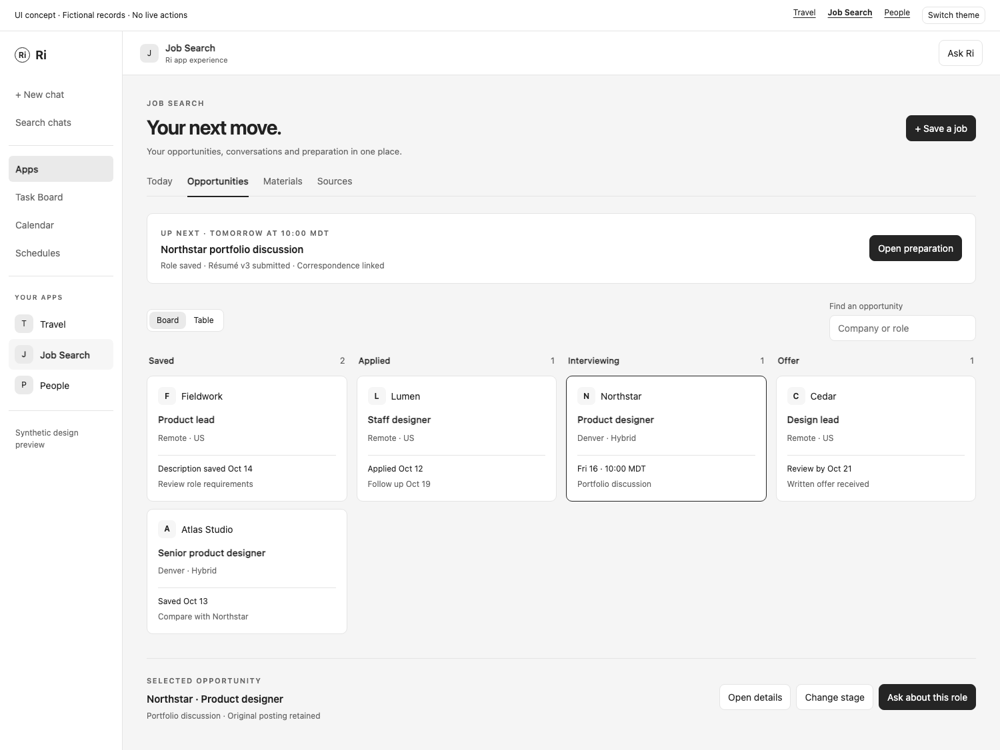

# Job Search app specification

October 15, 2026. Proposed implementation scope. Read with the [included apps foundation](included-apps-foundation.md) for packaging, sync, account access, native chat and shared release checks. Job Search works independently of People, Travel and Finances.

Job Search keeps the description, correspondence, submitted materials, interviews and next action for every opportunity together. Its first useful moment is opening an upcoming interview and finding the exact role, application and conversation history ready to work with.

[Interactive UI concept](mockups/job-search-app.html). Fictional records illustrate the pipeline, opportunity detail, interview preparation and native chat handoff. No real jobs, applications or messages are used.



## Product outcome and first release

Complete the loop from saving an opportunity to preparing for its interview: capture the original posting, attach application materials, observe correspondence, track the current stage, prepare with evidence and create the next Ri task.

Include saved postings, an application pipeline, a focused Today view, versioned materials, email matching, calendar interview matching, editable preparation notes and explicit follow-ups. Gmail and Google Calendar are the first provider targets. Files and manual records make the same loop usable without connecting an account.

Automatic applications, unsolicited outreach, employer account access, universal job-board search, salary prediction, psychometric scoring and automatic candidate ranking are outside MVP. These exclusions do not prevent Ri from helping the user draft or reason about their own materials in chat.

## Entry and setup

Display name Job Search, package `ri-job-search`, suggested route `/apps/job-search`, source picker label `Job Search`. Typing `@` selects a stable source chip, with `@Job Search` as its human-readable representation.

The first screen says "Keep your next opportunity together" and offers Save a job and Connect email. Save a job accepts pasted text, a PDF/document or a URL with pasted description. Store a link immediately even if its content cannot be fetched. URL fetching is a separately qualified host capability, not guest networking or a requirement to save a job.

Ask for company, role and the original description. Other fields can stay empty. A résumé upload is optional. An email connection offers a default 90-day history range and a preview of application-related matches. Gmail connection alone is enough for mail tracking. Calendar access is separately selected for interviews. The app does not read every available account by default.

## Information architecture

| Surface | Purpose |
| --- | --- |
| Today | Upcoming interviews, explicit deadlines, responses needing attention and the next chosen action. Show dates and evidence, not a productivity score. |
| Opportunities | Board and table views of the same records. Search by company/role, filter by stage and archive state. |
| Opportunity | Overview, original posting, correspondence, materials and interviews in one detail workspace. |
| Materials | Reusable résumé and cover-letter versions, plus which opportunities used each version. |
| Sources | Connections, imported files, coverage, matching review and sync state. |

New users land on Opportunities. Once there is a scheduled interview or due action, Today is the useful default. Preserve the last selected view during ordinary navigation. Completed searches can be archived without erasing the user's work.

## Main screen concept

The board is compact and practical. Initial columns are Saved, Applied, Interviewing and Offer. Closed is a filter/view containing Rejected, Withdrawn and Accepted outcomes. Each card shows company, role, location/work arrangement when known, next event/action and last observed activity. Avoid speculative fit percentages or rainbow stage colors.

```text
Job Search                                  Save a job   Ask Ri
Today   Opportunities   Materials   Sources
Board / Table                        Search company or role

Saved             Applied            Interviewing       Offer
Fieldwork         Lumen              Northstar          Cedar
Product lead      Staff designer     Product designer   Design lead
Remote            Sent Oct 12        Fri 16, 10:00       Review by Oct 21
Compare role      Follow up Oct 19   Prepare             Review terms

Selected: Northstar / Product designer
Interview: Portfolio discussion, Friday at 10:00 MDT
Posting   Correspondence   Materials   Interviews
Resume v3 submitted Oct 9       Open preparation
```

Selecting a card opens the opportunity detail beside the board at wide widths. With native chat open or a smaller app container, replace the board with a full detail view and an obvious Back to opportunities action. On mobile, use stage sections or the table's row-card equivalent, not a horizontally scrolling four-column board. Moving a stage works through an accessible menu as well as optional drag-and-drop.

The interview workspace leads with the time, zone, meeting link, participants and interview format if known. Below, show three useful blocks: the role's stated requirements, the user's relevant examples and questions to ask. Keep sources adjacent. A compact panel lists submitted materials and correspondence. The main action is Prepare with Ri, which stages a scoped prompt in native chat.

Materials use a version list and a document reader. Show original, edited and submitted states explicitly. A new draft never changes an already recorded submission. The user can compare text versions and choose which one to attach to an opportunity.

## Stage and communication rules

| Evidence or action | Behavior |
| --- | --- |
| Saved posting | Create Saved opportunity and immutable posting snapshot. |
| User marks applied | Record Applied with user-entered date and selected submission material versions. |
| Exact application acknowledgment | Link the source and suggest Applied, or update automatically when identity is unambiguous and no user override conflicts. |
| Invitation to choose interview times | Show Scheduling needed. It is not a scheduled interview. |
| Matching calendar event or confirmed appointment | Create/update the interview, with participant and time-zone evidence. |
| Rescheduled or canceled interview | Update that interview identity and retain history. Never mark the entire application rejected from a canceled meeting. |
| Offer or rejection correspondence | Require strong opportunity matching. Ambiguous or multi-role correspondence goes to Review. |
| Manual stage correction | Persist the correction and suppress contradictory automatic changes until the user resolves them. |

A stage is a summary of known progress, not an employer's authoritative internal state. Always allow the user to inspect the source. A company domain alone is insufficient to attach a message to one of several roles. Suggested follow-ups are labeled suggestions. Silence is not a rejection and does not generate a fake deadline.

## Connectors and inputs

| Input | MVP use | Qualification |
| --- | --- | --- |
| Gmail | Search application messages, read matching threads and attachments, incrementally track responses | Read-only selected account. Include sent messages so the user's actions are represented. Apply the shared sync requirements. |
| Google Calendar | Match and display selected interview events | Participants, recurrence, cancellation, pagination and original zones need the shared adapter work. No invitation write scope. |
| Files and paste | Posting snapshots, résumés, cover letters and interview notes | Host-mediated upload/extraction. Retain exact original files and submitted versions. |
| Drive and Docs | Import/export chosen materials | Later scoped addition. Local files are sufficient initially. |
| Greenhouse and Lever | Discover published jobs at selected companies | Later adapters can read public company postings. They do not expose the user's application status across employers. |
| Outlook | Equivalent mail/calendar loop | Subsequent live provider qualification. |
| People | Find known contacts and record an introduction request | Optional future app-to-app action with independent permission. Job Search owns its own contact snapshots initially. |
| LinkedIn and other job boards | User-saved links, text and exported records | No universal account sync or scraping dependency. |

Greenhouse exposes public read endpoints for its job boards. Lever exposes published postings scoped by company. Treat these as discovery sources with source dates, not as a general applicant portal integration. [Greenhouse Job Board API](https://docs.greenhouse.io/job-board.html), [Lever Postings API](https://github.com/lever/postings-api)

## Domain records and action contract

| Record | Fields and behavior |
| --- | --- |
| Opportunity | Company, role, source URL, location/work arrangement, stage, closed outcome, next action, revision and archive time. Unknown values remain unknown. |
| Posting snapshot | Opportunity ID, captured time, source URL/file, content digest, original text and extracted fields with provenance. Preserve earlier snapshots when the page changes. |
| Stage event | Opportunity ID, old/new stage, event time, author/source, confidence category, decision and revision. |
| Correspondence | Account/message/thread identity, participants, source time, bounded evidence, proposed/matched opportunity and match basis. |
| Interview | Opportunity ID, calendar identity or manual source, start/end instants, original zone, format, participants, link, status and preparation reference. Recurring occurrences have distinct keys. |
| Material version | Immutable ID, family/type, parent version, title, content/file digest, created time and author. Editing creates a new version. |
| Submission | Opportunity ID, applied time, exact material version IDs, evidence, channel and user confirmation where no receipt exists. |
| Preparation | Interview ID, sourced role requirements, user-authored experience examples, questions, notes and revision. |
| Follow-up link | Opportunity/interview ID, stable operation ID and Ri task reference. No separate task engine. |

Use exact money values and currency for stated compensation ranges. Preserve period and qualifiers such as base versus total compensation. Do not normalize an annual salary and an hourly rate without explicit assumptions. Keep offer details scoped to the relevant opportunity.

Alongside the common actions, implement `list_opportunities`, `get_opportunity`, `save_opportunity`, `change_stage`, `list_interviews`, `save_interview`, `list_materials`, `save_material_version`, `record_submission`, `get_preparation`, `save_preparation` and `resolve_match`. Reads are paginated and scoped. Writes use revision checks and persistent mutation IDs. `change_stage` records history. `record_submission` never sends an application.

Preparation generation uses supplied evidence and the qualified bounded AI path. It may propose ways to present actual experience, but cannot invent employment, achievements or credentials. Keep generated suggestions separate from user-authored facts and submitted materials. Missing model support leaves the preparation workspace usable for manual notes and ordinary Ri chat.

## Native chat examples

"Prepare me for this interview" includes the selected interview, posting snapshot, exact submitted materials and relevant permitted correspondence. "Compare these roles" uses only selected opportunities and known fields. "Help me follow up" creates editable draft text, with the intended recipient and thread visible, without sending.

The UI can stage any of those questions in the existing composer. App context resolution rechecks current opportunity scope and versions. Navigating to another opportunity before a send must visibly update or retain the selected context, never silently substitute an unrelated application.

## States and recovery

An empty pipeline offers Save a job. A saved URL with no description says "Add the description to prepare with this role". A closed listing still opens its retained snapshot. An ambiguous recruiter thread shows candidate opportunities and the evidence for each match, with an Ignore choice. An expired connection preserves local records and labels stale coverage.

Refresh preserves preparation notes and material drafts. Interrupted parsing resumes from a saved import without duplicating opportunities. A missing source is labeled unavailable. A calendar deletion updates the interview and never erases preparation notes or submission history. Review queues group related evidence so one thread does not create many repetitive prompts.

## Implementation sequence and acceptance

1. Build the packaged fictional board/table, opportunity detail, preparation screen and material version UI. Qualify native chat, keyboard stage changes and narrow layouts.
2. Implement posting capture, revisioned opportunities, immutable materials/submissions, manual interviews and source review.
3. Qualify Gmail matching and calendar updates. Add bounded background processing, confidence rules and persistent corrections.
4. Complete Ri follow-ups, source management, personal export and lifecycle qualification. Document supported providers and actions in the package.

Release requires the shared checks plus:

- Two roles at one company and two recruiter threads remain correctly separated.
- A posting that changes or disappears preserves the version used for preparation.
- Editing résumé v3 produces v4 while an existing submission still points to v3.
- An invitation, confirmed interview, reschedule and cancellation produce accurate states and time zones without an invented rejection.
- An acknowledgment imported twice creates one application event. A manual stage override survives the next sync.
- A generated preparation answer identifies its source and does not invent user experience. Unsupported extraction shows a usable manual path.
- An Ask Ri action preserves the native draft, stages the intended source context and performs no application or email send.

Later work may add selected-company job feeds, approved outbound actions, scoped People references and more document providers. These must preserve a useful, low-maintenance opportunity workspace.
