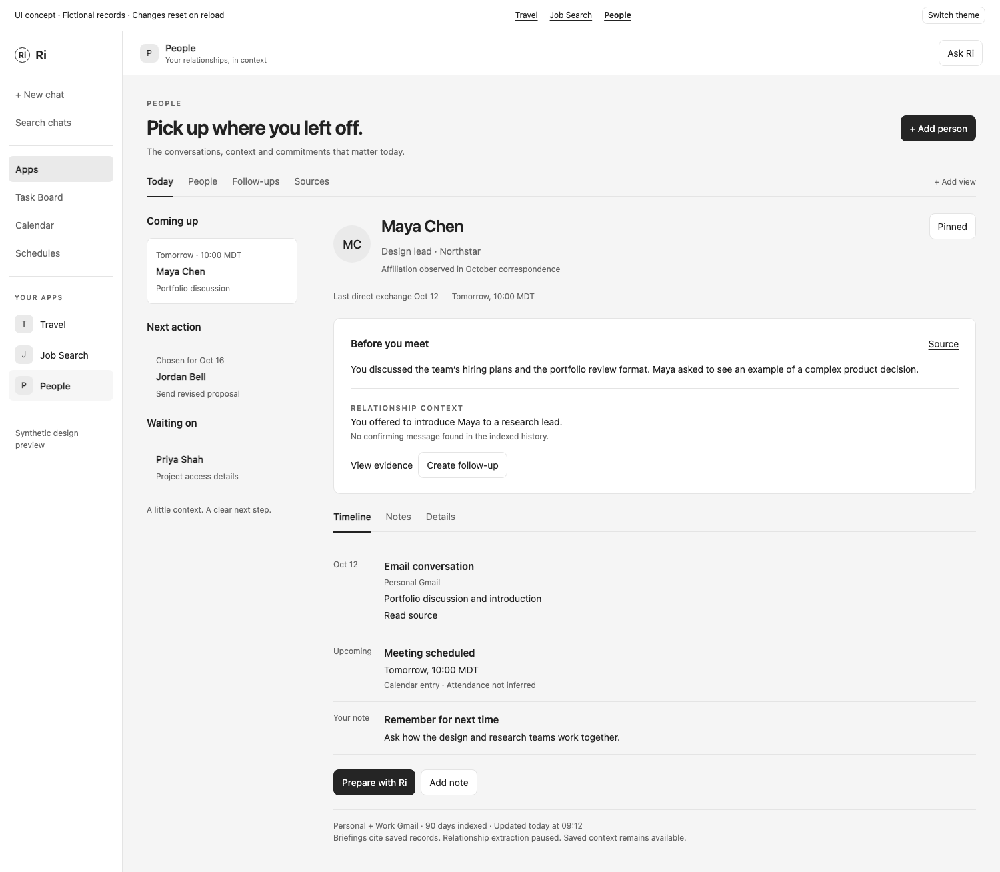
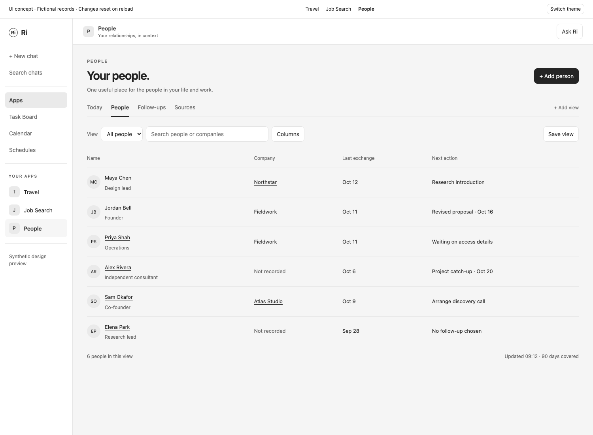
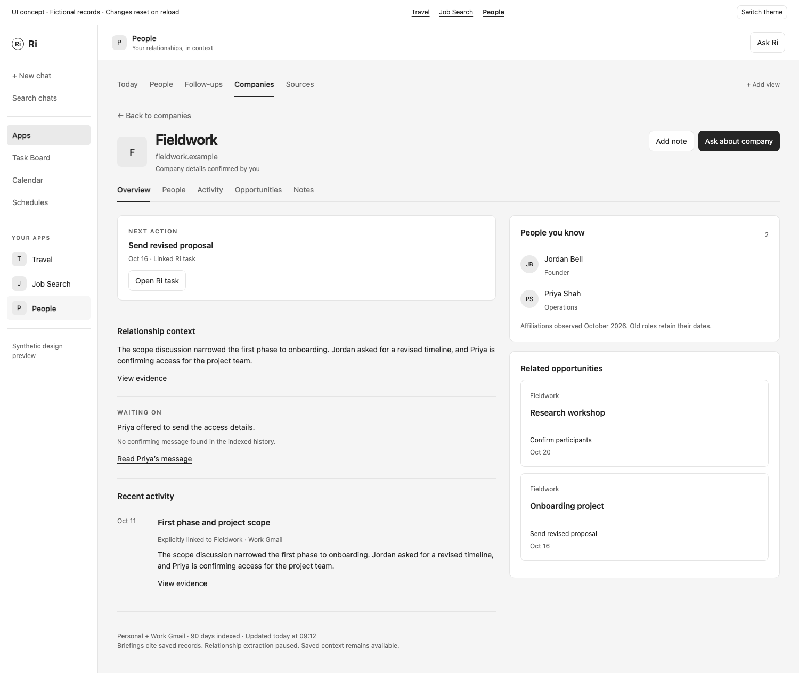
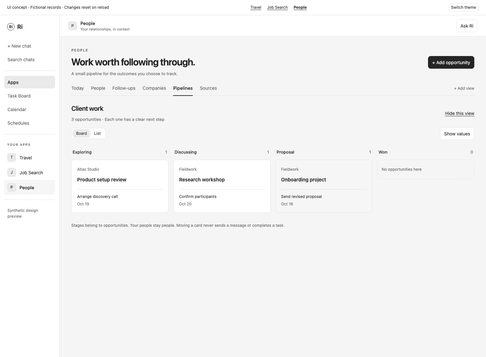

# People app specification

October 15, 2026. Implementation scope for People, Ri's lightweight personal and professional CRM. Read with the [included apps foundation](included-apps-foundation.md) for runtime, scoped access, ingestion and shared release checks. This revision adopts Ri's own bounded ingestion and relationship context. Gbrain is not a dependency. These are requirements, not a claim that the app is implemented.

People helps someone remember a relationship and follow through, whether they have twenty important contacts or thousands of professional ones. It begins with people, conversations and meetings. Companies, saved lists and small opportunity pipelines expand the same experience when the person needs them. There is one app, one set of records and no migration from a personal mode to a business mode.

Keep the display name **People**, mention **@People**, package `ri-people` and suggested route `/apps/people`. Describe it in the Apps library as "Your relationships, conversations and follow-ups in one place." CRM describes the product category. It does not become another navigation label or a setup decision.

[Interactive UI concept](mockups/people-app.html). Fictional records demonstrate a meeting briefing, CRM directory, company workspace, optional pipeline and native chat handoff. Changes in the concept reset on reload and never access an account.



## Product outcome and release boundary

Complete the loop from an interaction to preparation and follow-through: discover a person, associate the right conversations and meetings, preserve context, surface an evidenced promise, and create a chosen Ri task. A professional user can also open a company, see the relevant people and shared work, and know the next action.

The first release includes:

- Selected Gmail and Google Calendar accounts, bounded updates, CSV/vCard and LinkedIn connection-file imports, and useful manual records without a connection.
- People and companies, dated affiliations, identity review with undo, searchable directories, notes, timelines and source-linked meeting briefings.
- Suggested commitments, waiting-on context, user-chosen follow-ups and links to Ri tasks.
- Saved views and manually curated lists over the same records, with useful filters, sorting and optional columns.
- An optional, deliberately small pipeline: named stages and opportunities linked to people or companies, a next action and an optional value. It is built in the same release but hidden until the user chooses it.

Do not require gbrain, a graph database, a new model provider, another daemon or a separate MCP memory server. The app uses its SQLite database, Ri's existing connectors, scheduler and bounded AI capability. The normal MCP Apps view and scoped app actions remain the integration with Ri.

Excluded from this release: campaigns, sequences, bulk outreach, automatic sends, lead scraping, unattended LinkedIn sync, sales forecasting, arbitrary custom objects, formulas, a workflow builder, multi-user assignments and team permissions. Thousands of records are a supported scale target, not a promise of an enterprise sales suite. Job Search keeps ownership of job applications and submitted materials. Client delivery, invoices and budgets do not become People objects.

## Grow without requiring configuration

| Need | What appears | How it becomes available |
| --- | --- | --- |
| Remember important people | Today, People, Follow-ups and Sources | Default navigation. No taxonomy, company or pipeline required. |
| Understand a business relationship | Companies and company pages | A company link on a person opens its page immediately. Add view can pin Companies. Manually creating the first company offers to pin it. Background discovery never rearranges navigation. |
| Focus on a subset | Named lists and saved views | Save the current filter or add selected records to a list. A Views picker holds them, with an explicit Pin option. |
| Track a concrete outcome | Pipelines, board/list views and opportunity pages | Add view → Pipeline, with one short preview and creation flow. No separate CRM setup wizard. |

Hide view only changes navigation. It does not delete records, change grants or stop sync. Empty optional surfaces offer one useful action, not sample KPIs. There is always an Add view entry, so optional functions remain discoverable. Sources and app settings hold access and automation controls, not ordinary CRM work.

The same person can be a friend, a collaborator and a contact at a company. Use dated affiliations, lists and linked opportunities rather than duplicate personal/business profiles or a required relationship type. Notes and imported accounts retain their own visibility. Linking two records never shares their private data automatically.

## Entry and setup

The welcome screen says "Pick up where you left off" and offers Connect email and calendar, Import contacts and Add a person. Select exact accounts and calendars, explain what is retained locally, and show a 90-day history default with 30/90/365-day choices. Import is bounded and resumable. Show usable records immediately rather than waiting for all history or AI extraction.

Begin with genuine outbound or two-way correspondence and small meetings involving the owner. Incoming-only contacts and imported rows can appear with an honest origin label. Bulk mail, no-reply senders, mailing lists and large-event co-attendees are excluded from automatic relationship summaries. The user can include a sender explicitly.

No one must classify a network before receiving value. Pin and Keep in touch are optional. A recurring reminder requires a chosen interval. Importing a contact creates no overdue obligation. Companies without known contacts and people without a company are both valid.

## Information architecture and CRM UI

| Surface | Main work |
| --- | --- |
| Today | Upcoming meetings, chosen follow-ups, waiting-on items and a short, sourced review queue. |
| People | A fast directory with saved views, filters and a record inspector. |
| Person | Briefing, conversation history, commitments, private notes, affiliations and linked opportunities. |
| Companies | A directory of organizations, known people, relevant exchanges and next actions. |
| Company | Shared relationship context, current and former contacts, attributed activity, notes and opportunities. |
| Follow-ups | Chosen Ri tasks, commitments and waiting-on items, with suggestions separately labeled. |
| Pipelines | Optional board or table for named opportunities, with stage, next action and linked records. |
| Sources | Connections, history, imports, coverage, excluded senders, identity review and update controls. |

Today is the populated default. If it has no meetings or chosen work, show "Nothing needs your attention" and offer the directory. Remember an explicitly chosen landing view. Do not manufacture urgent work to populate a dashboard.

### Directory and saved views

The directory should feel like a polished CRM working surface, not a collection of large profile cards. Use the neutral Finances palette, restrained borders, compact text and real records. No colored avatar rainbow, relationship score or generic KPI row.

```text
People                                         Add person   Ask Ri
Today   People   Follow-ups   Companies   Sources   + Add view

All people ▾   Search people…   Filter   Columns   Save view

Name               Company / role       Last exchange   Next action
Maya Chen          Northstar / Design   Oct 12          Introduction
Jordan Bell        Fieldwork / Founder Oct 11          Proposal · Oct 16
Alex Rivera        Independent         Oct 6           Catch-up · Oct 20

3 people in this view                Updated 09:12 · 90 days covered
```

Default columns: name, known company/role, latest direct exchange and next action. Optional columns: next meeting, primary email, lists, coverage and date added. Company rows use name, known contacts, last attributed exchange and next action. Sortable headers, a sticky name column, visible active filters and Clear filters make a large directory manageable. A missing value is shown as unavailable, not inferred to fill a cell.

MVP filter vocabulary is explicit: text search, company, list, pinned, has follow-up, next-meeting date and last-direct-exchange date, plus archive state and permitted source. Combine chosen filters with AND. Multiple values in one field mean OR. A saved view stores these filters, sort and columns. A list stores chosen memberships. Neither copies records or grants access. A saved source filter that is no longer permitted shows an unavailable filter rather than broadening the result.

Support a searchable Views picker, manual list membership, selection of at most 50 loaded records and a small bulk menu for pin, list membership and archive. Bulk changes show the selected count and apply expected revisions, with per-record failures visible. No select-all-across-an-unbounded-query or bulk outreach. User-owned name, note, list and opportunity fields can be edited in place. A sourced field opens a correction control with its original evidence.

Selecting a row opens an inspector and preserves query, cursor, scroll and selection. Enter opens the record, Escape closes the inspector, and Back restores the directory. Existing Ri commands own global shortcuts. Local keyboard navigation does not override typing or native chat shortcuts. At narrow widths use concise rows and a dedicated detail page, not a miniature desktop table. Use text links and buttons for essential actions, never hover-only controls.



### Person and meeting preparation

On Today, use a compact list of actionable people beside a generous selected-person workspace. On a directory, the full record is reached through its inspector. Avoid simultaneously squeezing list, inspector, record and chat into narrow columns.

The person header shows neutral initials or a chosen image, name, sourced role/company with observation date, last direct exchange and next meeting. Actions are Add note, Follow up and Ask Ri. Timeline, Notes and Details are record sections. Related companies and opportunities are compact links, not competing dashboards.

Before you meet gives a short, sourced briefing: recent discussion, explicit notes, open promises on each side and what remains unknown. Every factual item opens evidence. A source inspector shows account, participants, source date, exact passage and an original-message link when available. Opening chat retains the selected record and stages editable text through Ri's native composer.

Timeline rows distinguish emails, notes, recorded meetings and user changes. A calendar event proves an appointment was recorded. Use "Meeting scheduled" or "Past calendar event" until attendance is confirmed. Sort by event time with a stable ID tie-breaker. A role observed in an old signature or import must not silently become current employment.

### Company workspace

Companies are first-class records in MVP. Internally the entity is `organization`, so a nonprofit, community, fund or school fits without a second model. The UI uses Companies consistently, with a help line explaining that other organizations work too. Company creation requires only a name. Website/domain and type are optional, and no enrichment subscription is required.

```text
Fieldwork                                     Add note   Ask Ri
fieldwork.example · Company details confirmed by you

Overview   People   Activity   Opportunities   Notes

Next action                   People you know
Send revised proposal         Jordan Bell · Founder
Due Oct 16 · Open Ri task      Priya Shah · Operations

Relationship context          Active opportunity
Smaller first phase requested Onboarding project · Proposal
Oct 11 conversation           $8,000 USD · Target Nov 1
View evidence                 Open opportunity
```

Overview answers who is involved, what was discussed, what each side is waiting on and what should happen next. People separates current, former and date-uncertain affiliations. Activity includes only explicitly linked or evidenced company interactions, deduplicating a conversation that involved several employees. A person's unrelated private exchanges do not become company history.

Company opportunities and monetary values appear only if created and permitted. Show a compact count and next action, not fabricated revenue or relationship health. A company page is useful with only a note and one contact. Later, multiple projects or partnerships can share the same company without duplicating it.



### Optional pipelines

A pipeline tracks a concrete opportunity, not a person's value. An opportunity has a title, pipeline, stage, linked people or company, optional next-action task and target date. Value and currency are optional and hidden by default. One person/company may participate in multiple opportunities. A personal contact never needs a stage.

Add pipeline asks for a name and offers editable stage suggestions: client work, introductions or a blank pipeline. These are templates over the same fields, not different schemas. Default stage kinds are `open`, `succeeded` and `closed`, with human-readable labels such as Exploring, Discussing, Proposal, Won and Closed. Store stable stage IDs separately from labels and order. Fundraising or partnership stages can be named by the user. Stage deletion requires replacement for occupied stages. Moving an opportunity to another pipeline requires a destination stage.

Board cards show title, company or person, next action and its date. A compact table uses the same query and selection. Dragging is optional, with a Move to stage menu and keyboard equivalent. Stage changes append history with who changed it and when. Email may suggest a change with evidence, but never moves a card or marks a deal won automatically. An accepted stage suggestion changes app records only.

Keep the first version deliberately finite: create/edit/archive opportunities, name/reorder stages, move cards, filter, attach existing people/companies and create a Ri follow-up. Values use integer minor units and an explicit currency. Never add currencies together or display a forecast. Closing an opportunity does not complete its tasks automatically. Hiding Pipelines retains its records and linked follow-ups.



### Adaptation and scale

At desktop widths, directories and boards get most of the space. In a 360 px companion frame or on mobile, use one list or record with Back. In a narrow pipeline, show a stage picker and stacked cards. Chat uses Ri's existing pane or app/chat switch. Preserve unsaved input during background updates and navigation. Color is reserved for a real overdue date, error or completed state, always accompanied by text.

At 10,000 people, 1,000 companies and 100,000 interactions, keep all lists and joins paginated and indexed. Initial list payload is at most 50 rows, a subsequent page at most 100. Never mount every row or hydrate full email bodies for a directory. Index/search work runs in the app process. Qualification measures repeated list/search/detail requests on that synthetic dataset on the documented dev machine, with p95 under 300 ms excluding process startup, provider calls and AI. Measure sync fairness and first-open time separately. These are release targets, not observed measurements.

## Lightweight relationship context

Use this pipeline inside People:

```text
Ri's selected Gmail / Calendar connections and manual imports
  → bounded sync → source records and SQLite indexes
  → deterministic identity and interaction linking
  → optional bounded extraction → reviewable facts and commitments
  → scoped record queries and context → People UI and native Ri chat
```

There is no global agent memory, automatic chat capture or gbrain process. MCP remains the existing app protocol. Ri owns authentication and scheduling. People owns its records and a small extraction module. Start with exact identifiers, SQLite full-text search and indexed joins. Embeddings, if later justified, are an optional retrieval improvement, never a prerequisite for the directory or meeting preparation. No generic knowledge graph or pluggable knowledge-engine framework is required.

Keep the valuable product ideas from gbrain:

| Idea | People requirement |
| --- | --- |
| Evidence attached to memory | Every extracted fact and promise references a retained source revision and passage. The source remains inspectable. |
| Who owes what to whom | Separate I owe, Waiting on and Suggestions. Preserve actor, recipient and explicit deadlines. |
| Corrections that survive | Store user decisions and withdrawals separately from imported values. Resync and a new extraction version cannot restore a rejected claim silently. |
| Time-aware knowledge | Distinguish when something happened, when it was observed and when it was valid. Preserve old affiliations. |
| Honest freshness | State which accounts and date ranges were checked, update time, held import failures and pending extraction. Missing evidence is not proof that nothing happened. |
| Useful context on demand | Return a small, cited record-specific context packet. Opening a record or reading context does not trigger a full sync or hidden AI work. |

These ideas are informed by gbrain's [Google ingestion and open-loop design](https://github.com/garrytan/gbrain/blob/master/docs/guides/google-connect.md), [commitment tracking](https://github.com/garrytan/gbrain/blob/master/docs/guides/open-loops.md) and [memory boundaries](https://github.com/garrytan/gbrain/blob/master/docs/guides/memory-boundaries.md). This specification adopts behavior, not gbrain code, runtime or operational configuration.

Deterministic import, identity matching, timeline, search and manual CRM operations work with AI disabled. Sources has a separate Extract relationship context switch, off until chosen, alongside automatic sync. Enabling it uses Ri's separately granted bounded AI capability and explains the text sent for processing. Unsupported harness or denied AI access leaves these manual features usable and reports extraction unavailable. Pause extraction cancels queued work and prevents new calls without stopping read-only sync.

Reuse the foundation's one five-minute host schedule and bounded `run_background_step`. Do not install another scheduler. Prioritize current deltas before deep history, rotate accounts, and alternate sync/enrichment so neither starves. Backfill remains within the chosen history range. Enrichment processes one bounded conversation, note or meeting batch, retaining the newest relevant evidence if truncation is required. Deduplicate by source revision and extraction version. Bound retries and surface failed items in Sources.

Generate meeting briefings ahead of time when relevant source data changes, with deduplicated jobs for meetings in the next seven days, or through an explicit Prepare action. A read returns the saved briefing with current coverage, or a deterministic summary of permitted meetings, notes and commitments. Show generated time and source coverage separately. Late source changes invalidate a stale briefing immediately, even if its replacement is still queued.

## Identity, companies and attribution

| Signal | Rule |
| --- | --- |
| Exact normalized email | Associate with its existing identity unless flagged shared. Preserve the original value. |
| Email normalization | Trim whitespace and normalize domain casing. Do not strip dots or plus suffixes or assume arbitrary local-part equivalence. Aliases are explicit. |
| Same name or company domain | Suggest a match, never merge people automatically. |
| New address in a signature | Propose an alias with evidence. It cannot replace a confirmed identity. |
| Shared inbox such as support@ | Mark as shared or a company contact address. Do not equate it with an employee. |
| Company name or website | Propose an organization match with evidence. A name alone is not unique. A domain is a candidate key, not proof that subsidiaries, brands or teams are identical. |
| Gmail address or shared email provider | Never infer a company from the provider's domain. A company on a custom domain still needs a sourced affiliation or user decision. |
| Signature, contact import or stated employer | Retain observed date and provenance. Distinguish an observed affiliation from user-confirmed current employment. |
| Calendar attendee | Attribute to that event. Co-attendance alone does not establish a relationship or employer. |
| Manual correction | Takes precedence over inference and survives resync and re-extraction. |

Register person, organization and opportunity entity descriptors. Known contacts discovered from sent mail, confirmed direct replies and meetings with the owner plus at most eight non-resource attendees may be created automatically. Larger events remain available as excluded-source counts and can be included explicitly. Determine list/no-reply behavior from provider headers and explicit rules before AI. User exclusions persist.

Organization discovery is conservative. A clear organization field in an imported contact can create a provisional company with its source date. Signature-derived companies and domain associations start as suggestions. Identity review can accept a company, affiliation and matching decision together. Confirmation is not required just to keep a useful email or person. Two organizations may share a name or domain.

Affiliations are many-to-many and dated. Moving jobs never moves old conversations to the new employer. An interaction's company association requires a manual link or a confirmed attribution rule. Offer "Include work conversations with this address" once, with an account, work identity, company, date range and preview of matching exchanges. Acceptance associates matching direct work exchanges on subsequent syncs, retaining the rule and original source for every link. It does not move notes, unrelated identities, out-of-range history or other account data. Removing the rule removes its exclusive derived links while keeping manual links. Ambiguous associations stay on the person timeline until resolved. Explicitly linked opportunities provide another deliberate association. This avoids reviewing every routine message or treating a domain as proof of employment.

Person/company merges create durable identity mappings and record the exact reference moves. Original IDs and evidence are retained. Undo restores original references and visibility. References added after a merge are listed for explicit attribution during undo rather than guessed or discarded. Conflicting revisions fail atomically. Rejected matches persist. Every projection still applies source and manual-collection scope, including counts, snippets, sort keys and company rollups.

## Commitments, waiting on and corrections

Extract possible commitments from a bounded conversation: actor, recipient, offered action, explicit due date, source passage and later relevant responses. A question with no reply is not automatically a promise. A response in a thread is not automatically fulfillment. Keep unanswered exchanges as low-priority context only when they contain an explicit request or were chosen by the user. Do not create obligations for all incoming mail or invent deadlines.

Follow-ups has I owe, Waiting on and Suggestions filters. Accepted commitments and Ri tasks are distinguished from inferred items. The user can accept, edit, dismiss, snooze or mark a commitment completed. Accepting a commitment records the user's decision. Create follow-up is the separately visible, explicit step that creates a Ri task. It may be offered as Accept and create task, with the proposed task and date shown. A commitment/opportunity can link an existing task without creating another one.

Suggested claims may be superseded or withdrawn by newer evidence. Show the resolution in history and remove it from active suggestions. A later response may suggest completion of an accepted commitment but cannot complete it or its Ri task automatically. Ri owns task status. A deleted/unavailable task link is shown as such and never silently recreated. Snooze controls presentation through `snoozedUntil`, without changing evidence or due dates.

"No confirming message found in the indexed history" is valid. "You did not do this" is not. Empty waiting-on results with stale accounts, failed imports or incomplete extraction must show partial coverage, not an all-clear. A new substantive version of a dismissed claim can be reviewed with the previous dismissal visible. Mere rephrasing or a model upgrade does not resurrect it.

Corrections use a stable source/claim decision key and retain both extracted and user values. Removing an incorrect fact from active context is distinct from deleting imported source data. Source deletion removes source-only facts, search entries and briefing caches, then recomputes mixed-source records. Export and backup restoration preserve decisions and withdrawals. Do not infer personality, closeness, health, politics or other sensitive traits to enrich profiles.

## Connectors and imports

| Input | Initial use | Boundary |
| --- | --- | --- |
| Gmail | Identities, sent/received messages, direct exchanges and bounded evidence | Selected read-only accounts, shared incremental-sync adapter. No mailbox modification or sending. |
| Google Calendar | Meetings, participants, organizer, recurrence, original time zone and changes | Qualify shared adapter extensions, cancellations and pagination before release. |
| CSV/vCard | People, company fields, contacts, notes and optional list membership | Preview mapping, duplicates and scope before apply. Preserve Unicode and unmapped source fields. |
| LinkedIn export | Connection rows and available company/role/profile fields | User-imported snapshot. Missing email is normal. No implied live freshness or unattended network access. |
| Google Contacts | Later address-book bootstrap and sync | Separate People API adapter. Not a prerequisite for mail/calendar MVP. |
| Microsoft Contacts and Outlook | Later equivalent source family | Additional adapters and live qualification. |
| Slack | Later selected conversations | Separate read grants and identity matching. |
| Existing CRM export | Map supported people/company/list fields through CSV preview | Preserve external IDs and unknown columns. Do not silently claim full CRM migration or writeback. |

Import preview shows create, update, proposed merge, skipped and unsupported counts. A source ID and content digest make repeated imports idempotent. People/company rows can be applied together transactionally. Manual records work offline. Optional opportunity CSV mapping is a later extension, not a release dependency.

Google's [People API](https://developers.google.com/people/v1/contacts) and [Microsoft Graph contacts](https://learn.microsoft.com/en-us/graph/api/user-list-contacts?view=graph-rest-1.0) are possible address-book adapters. LinkedIn's [Connections API](https://learn.microsoft.com/en-us/linkedin/shared/integrations/people/connections-api) requires approved access. The initial path is the user's [exported connections](https://www.linkedin.com/help/linkedin/answer/a566336/exporting-connections-from-linkedin), including only available fields. Do not advertise a live LinkedIn connection until qualified for the intended users.

## Domain records and contracts

All records live in the app's schema with immutable IDs, timestamps and revisions. Manual content has an explicit collection scope. Imported evidence carries source account scope. Neither a list nor a company is an implicit permission container.

| Record | Required fields and invariants |
| --- | --- |
| Person | Name, user overrides, pinned/archive state and revision. No required company or business classification. |
| Identity | Person or organization reference, kind, original/normalized value, shared-address flag, source and confirmation. Reliable non-shared keys prevent duplicate attribution within the permitted source model. |
| Organization | Name, optional type/website, user overrides, provisional/confirmed state and archive state. Domains and aliases are separate evidenced identities. |
| Affiliation | Person, organization, optional role, valid-from/to when known, observed date, current-status confidence, evidence and correction. Dates can be unknown. No single employer field as the source of truth. |
| Company attribution rule | Account, confirmed work identity, organization, effective range, user decision and revision. Derived interaction links retain the rule ID. Explicit exclusions override it. |
| Interaction and participants | Provider/connection/external ID or occurrence key, kind, event time, subject, direction, participant identity references and evidence revision. Separate scoped links to organizations/opportunities. |
| Fact and decision | Subject entity, field/claim key, value, evidence and revision, observed/effective dates, extraction version, active/superseded/withdrawn status, user correction or durable rejection. |
| Note | Subject entity, user-authored body, explicit manual collection and revision. Company links require a chosen destination scope. |
| Commitment | Actor, recipient, proposed action, optional due date, evidence, suggested/accepted/dismissed/completed/withdrawn state, snoozedUntil, revision and optional Ri task link. Only inferred suggestions auto-withdraw. |
| Task link | Entity/commitment, host task ID, durable operation ID and last known status. Ri remains authoritative. |
| List and membership | Name, person/company record kind, collection, ordered membership and revision. A list has one record kind, not an arbitrary mixed entity collection. |
| Saved view | Record kind, allowlisted filters, sort, columns, optional list/pipeline reference, label and navigation preference. Evaluated against current scope every time. |
| Pipeline and stage | Name, ordered stable stage IDs, stage kind, archive state and revisions. Labels are editable. No stage names in business logic. |
| Opportunity | Title, pipeline/stage IDs, linked people/company, optional target date, value minor units/currency, task link and explicit collection scope. Value and currency are either both set or both absent. |
| Stage change | Opportunity, old/new stage, actor, time, mutation ID and optional accepted suggestion/evidence. Append-only history. |
| Identity decision | Candidate IDs, match evidence, merge/undo reference moves and durable rejection. |
| Briefing | Subject/meeting, evidence IDs and revisions, scope fingerprint, generated time, extraction version and bounded content. Never reuse a broader-scope summary for a narrower reader. |

Use normalized joins for memberships and affiliation history, not duplicated contact JSON inside every company. Index identity lookups, person/organization interaction time, source keys, active commitments, list memberships and pipeline/stage order. Search indexes point to scoped source records, and filter before ranking/counting. Derived next-action and last-exchange values must be recomputed from permitted rows, not leaked from an owner's global cache.

Use the foundation's strict action contract, revision checks, durable mutation IDs, bounded cursors and trusted scope reference. Common source/import/scheduling actions remain unchanged. Define these app actions with typed input/output schemas and fixture examples:

| Group | Actions |
| --- | --- |
| People and organizations | `list_people`, `get_person`, `search_people`, `save_person`, `list_organizations`, `get_organization`, `save_organization`, `save_affiliation`, `list_interactions`, `link_interaction`, `preview_company_attribution`, `apply_company_attribution` |
| Relationship context | `save_note`, `list_commitments`, `review_commitment`, `review_fact`, `get_briefing`, `request_briefing`, `get_relationship_context` |
| Views and lists | `list_views`, `save_view`, `list_lists`, `save_list`, `update_list_members`, `bulk_update_records` |
| Pipelines | `list_pipelines`, `save_pipeline`, `save_pipeline_stages`, `list_opportunities`, `get_opportunity`, `save_opportunity`, `move_opportunity` |
| Identity management | `resolve_identity`, `merge_people`, `merge_organizations`, `undo_merge` |

Saved filters are structured objects over the vocabulary above, never executable SQL or code. Stage mutations name stable IDs and expected revisions. Archive is a field update. `request_briefing` enqueues a deduplicated app job and returns its ID, coverage and availability. `get_briefing` and `get_relationship_context` are read-only. Merge/undo, source management, navigation setup and pipeline-structure changes are user-only for MVP. Other agent writes require the user's request and the current app write grant. A model may not invent a broader scope.

Company-attribution preview is a bounded read returning a rule draft, representative matches, coverage and an expiring digest. Apply is user-only, uses that preview digest and revisions, and queues bounded linking work. It cannot expand the selected account/date range. Rules can be disabled through the same revision-checked action. Membership in a company never confers access to its underlying sources.

`get_relationship_context` takes subject kind/ID, optional meeting/date range and returns at most 20 facts/commitments and 20 interaction references, with evidence excerpts within the foundation's capability text limit. Include as-of time, covered accounts/ranges, missing evidence and pending extraction. Selection context stays within 50 IDs and 8 KiB. Backend lookup rechecks every ID, source, operation and manual collection. A larger request returns truncation and a next cursor, never an unbounded prompt.

Cached briefings are keyed by exact scope fingerprint and evidence revisions. Deletion, correction, merge, revocation or a relevant source change invalidates them. If a safe projection is unavailable, return deterministic permitted records and a pending briefing rather than serving cached private prose. Company-level summaries, pipeline cards, counts and search suggestions obey the same rule.

## Native chat examples

"Prepare me for my meeting with Maya" gathers permitted recent exchanges, notes, that meeting and open commitments. "What did I promise Jordan?" returns evidence-backed suggestions and accepted commitments. "Who do I know at Northstar?" distinguishes observed/current/former affiliations and dates them.

"What is happening with Fieldwork?" returns explicitly associated activity, people, opportunities and next actions. "Show clients I have not spoken to in a month" creates a preview of a filtered view, using the user's chosen Clients list rather than guessing who is a client. Saving that view is an explicit app write. "Move the onboarding project to Proposal" uses the named opportunity and pipeline stage, with normal write authority and revision checks.

"Help me reconnect" stages an editable draft. Nothing sends, invites or enrolls a contact in a campaign. The native source chip describes the selected person, company, opportunity or bounded view. Existing draft text and attachments survive a context change.

## States, export and recovery

Show usable records while initial import runs, with indexed date range and pending work. No matches explains which sources and filters were checked. Stale/partial coverage stays visible in briefings, waiting-on and company summaries. A source failure does not block unrelated manual edits or accounts. Offline records remain useful with their last-known coverage.

Identity review shows both records, shared identifiers, evidence and Merge/Keep separate controls. Undo has a preview, including references created after the merge. A stale merge fails atomically. Opportunity moves and task creation are idempotent. Refresh never overwrites typed notes or an in-progress correction.

Disconnect, delete imported data and backup restore follow the foundation. Deleting a person/company distinguishes archive, removal of imported data and suppression of rediscovery, with a visible choice for authored notes and links. Suppression retains only the necessary scoped identifier and can be reversed in Sources. Deleting a company never deletes its people or Ri tasks. Removing an app leaves deliberately created Ri tasks intact.

Owner export includes scoped CSV tables for people, companies, affiliations, lists, opportunities and stages, plus JSON for notes, evidence references, corrections and identity decisions. Include stable IDs and an export-format version. Do not call CSV a full backup. Whole-instance restore uses the host snapshot boundary, including source files, task links and decisions, followed by permission review. Exporting a filtered view never includes hidden accounts or full source bodies by default.

## Implementation sequence and acceptance

1. Build and qualify the synthetic Today view, directory, person and company workspaces, optional pipeline, responsive navigation and native chat handoff. A simple personal setup must remain simple.
2. Implement the domain schema, manual people/companies, dated affiliations, notes, lists/views, pipeline/stage mutations, imports and merge/undo. Prove manual CRM use without connectors or AI.
3. Qualify Gmail/calendar ingestion, exclusions, company attribution and mixed-account projections. Complete the commitment-to-Ri-task loop and lifecycle checks.
4. Add opted-in bounded extraction, waiting-on review, source-linked briefings, correction persistence, performance qualification and export/restore checks.

Release requires the shared checks plus:

- A person with twenty contacts gets preparation and follow-ups without configuring companies, lists or stages. Enabling and hiding Companies/Pipelines preserves IDs, notes, filters, grants and task links.
- A consultant can create two opportunities at one company, associate different contacts, move a stage and create one dated Ri task. A friend can remain entirely outside pipelines.
- Company and directory views work at 390 px, a 360 px companion frame, dark theme, 200% text zoom and by keyboard. Filters and scroll survive Back. Pipeline stage changes have a non-drag path.
- Same-name people, shared inboxes, plus aliases, shared company domains and two separate accounts remain distinct until justified or explicitly merged. Merge/undo preserves later references without guesses or loss.
- An employee changes companies without moving historical exchanges or private notes into the new company. An old imported role retains its date. Company activity deduplicates a multi-person thread.
- A confirmed company-attribution rule includes later qualifying exchanges without per-message review. Exclusions, rule removal and date changes retract only its derived links and invalidate affected summaries.
- A 100-attendee webinar and a newsletter do not automatically fill the directory. A direct reply does. An invitation or canceled event never implies attendance.
- A promise shows source evidence and creates no task until chosen. A later unrelated reply does not close it. Completion evidence can resolve a suggestion but never silently complete a user commitment or Ri task.
- Dismissal, correction and withdrawal survive resync, a changed extraction version and backup restore. A new substantive claim explains why it is being reviewed again.
- A stale account, held message failure or pending extraction produces partial coverage rather than an all-clear. One source's backfill cannot starve another source or current changes.
- With AI disabled, no `ai_text` capability is invoked, including on sync, search, record open and context read. Manual CRM, deterministic identity linking and saved-source preparation still work.
- Removing a source removes its exclusive facts and search results without erasing independent notes. A narrower chat cannot infer hidden companies, stages, amounts, participants or activity through counts, sort order, snippets or cached briefings.
- Concurrent stage moves use revision checks. A deleted stage cannot orphan opportunities. A failed/retried follow-up creates one Ri task. Two currencies are never summed together.
- Large synthetic records meet the stated bounded-query and measured latency target. Record open starts no import, full-table scan or AI call.
- Scoped export and full restore preserve stable IDs, memberships, stage history, corrections and decisions. Archive/removal does not delete Ri tasks.

People is independently useful. Future references from Travel, Job Search or a client-work app use public actions and explicit grants. The domain stays inside People, so the app can be removed without turning Ri core into a CRM.
