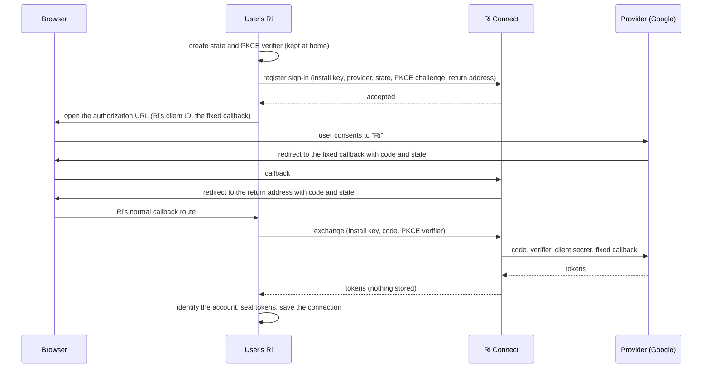

# Ri Connect: connecting accounts without bringing your own keys

**Status:** Proposal. Nothing here is built. **Date:** October 15, 2026.

This spec gathers the ideas from an October 15 planning chat about Composio, the other integration platforms, and building Ri's own service, compares them with the [managed connectors proposal](integrations-managed-connections-proposal.md) written the same day, and turns the result into one plan. Outside facts were checked against provider documentation on October 15, 2026 (Sources, at the end).

It builds on the [integrations module spec](integrations-module-spec.md) (§15 prior art, §20 the paid hosted mode), the [auth config spec](integrations-authconfig-spec.md) (more than one OAuth app per provider), the [desktop callback relay](desktop.md#hosted-https-callback-relay) and the [beamd hosted auth spec](beamd-hosted-auth-spec.md). "Ri Connect" is a working name.

## Summary

Most of Ri's connectors already connect with a browser sign-in and nothing else. The setup burden sits in 13 connectors, Google among them, where the user has to register their own OAuth app with the provider before they can sign in. That's a developer task. For Google it also comes with sign-ins that expire every 7 days unless the app passes Google's review.

What Composio and similar platforms sell is a way around this: an OAuth app the provider has already approved, which any user can consent to. Ri can own that directly.

1. **Ri gets its own OAuth apps approved**, starting with Google Calendar.
2. **A small service on the beamd account, Ri Connect, hands those apps to the user's Ri.** It owns the one fixed callback address every sign-in returns to. For apps that have a client secret, it also holds the secret and finishes each sign-in and refresh. It stores nothing about anyone's accounts.
3. **Account tokens stay in the user's Ri, and calls go straight from Ri to Gmail or Slack.** Mail and messages never pass through Ri's servers.
4. **It's a paid feature of the beamd account**, sold alongside remote access. Bringing your own OAuth app stays free, which keeps the open-source version whole.
5. **Composio isn't part of it.** The managed proposal would route every call through Ri's service and Composio. That's faster to a first Gmail, but it costs per call, puts everyone's mail on two outside servers, and leaves Ri owning nothing (§4).

The work starts with paperwork, not code. Google Calendar's review is light. Gmail needs a yearly security assessment that Google requires even when mail never reaches a server. The decisions this needs are in §14.

## 1. Terms

| Term | Meaning |
| --- | --- |
| OAuth app (client) | An app registered with a provider such as Google. Users see its name on the consent screen ("Ri wants to access your Google Account"). |
| Client ID | The app's public identifier. It is safe to ship in the app. |
| Client secret | The app's password, used to turn sign-in codes into tokens and to refresh them. Whoever holds it can act as the app, so it can't ship in an open-source download. |
| Confidential client | An app that has a secret and keeps it on a server. |
| Public client | An app with no secret, such as a desktop or phone app. It proves itself with a PKCE verifier instead. |
| Callback address | Where the provider sends the browser after consent. It must exactly match an address registered with the app. |
| Authorization code | The short-lived, single-use code the provider hands back through the browser. It is exchanged for tokens. |
| PKCE verifier | A one-time random value the app creates at the start of sign-in. The code can't be exchanged without it. |
| Access token | What a call to Gmail or Slack carries. It expires quickly, usually after an hour. |
| Refresh token | Long-lived. It gets new access tokens. A confidential client also needs its secret to use it. |
| Verification / review | The provider's approval of an app for public use. Google requires it for sensitive data such as calendars, plus a security assessment (CASA) for restricted data such as Gmail. |

## 2. The problem

Of Ri's [69 connectors](integrations-current.md), here is what each asks of the user:

| What the user must bring | Count | Connectors |
| --- | --- | --- |
| Nothing but a browser sign-in (or no account at all) | 46 | Notion, Linear, Atlassian, Airtable, ClickUp, Todoist, Stripe, Figma and the rest of the browser sign-in list, plus Exa, Microsoft Learn and 1Password |
| Their own registered OAuth app | 13 | Slack, Zoom, HubSpot, Asana, Box, Dropbox, X and Docusign (hosted MCP), Google, Microsoft 365, Salesforce, QuickBooks and Discord (native) |
| A token or account credentials | 10 | GitHub, Zapier, monday.com, Smartsheet, Wrike (hosted MCP), Mailgun, Plaid, Telegram, WhatsApp and Zendesk (native) |

Ri won't connect the 13 until a client ID and secret are added in Settings. For MCP servers the check is in `src/lib/integrations/hosted-oauth-config.ts`, and for native connectors the engine returns `provider_not_configured`. Registering an app means opening the provider's developer console, creating an app, pasting Ri's callback address, choosing scopes and copying the credentials back.

**Google is the worst case and the most used.** Gmail, Calendar and Drive drive the deck and the calendar. Google's official Gmail, Calendar and Drive MCP servers, still in Developer Preview, also need your own Cloud project and OAuth setup ([integration notes](integration-audit/notes.md)). A Google project in "Testing" status gets refresh tokens that expire after 7 days and is limited to 100 test users. Publishing one with Gmail access means passing Google's review and a yearly security assessment, which no individual user will do.

**What a "direct connection" really is.** Someone else's already-approved OAuth app asks the user for consent. That approval is the asset. Connector code mostly isn't, since providers now run their own MCP servers and Ri already connects to 59 of them.

**The 10 token connectors are a different problem.** Most of those tokens are the account itself, such as a Mailgun API key, a Telegram bot token or a Plaid key, and no OAuth app removes them. Two may change separately. Zapier's server advertises standard MCP sign-in, though Zapier documents it only for clients on its list and tells others to use a connection token (§13, phase 1). GitHub could later get a Ri Connect app.

## 3. Three ways to remove keys

The planning chat looked at three ways to plug in "someone else's approved app". They differ in who holds the account tokens and where calls go.

### 3.1 A platform as a single connector

Composio's one-URL server (`connect.composio.dev/mcp`) answers with standard MCP sign-in, so a user can probably paste it into Plugins → MCP servers today. It's the quickest experiment, and it's the wrong design.

These servers expose generic tools such as "search tools" and "execute tool". Ri decides approvals by tool name (`src/lib/integrations/mcp-approval-policy.ts`), so "read my inbox" and "send this email" both arrive as `execute`. Either every call asks for approval or none does. The accounts also live in the platform's own screens, so Ri's Connectors list, multiple accounts, per-agent tool choices, `request_connection` and the audit log can't see them.

### 3.2 A platform as a source of connections

Ri talks to the platform's API instead of its one-URL server. Each account connected through the platform becomes a normal Ri connection, shown as "Gmail" with a small "via Composio" note, and its tools keep their real names. This is the "optional adapter behind the same ports" that [module spec §15](integrations-module-spec.md#15-prior-art-policy) anticipated. The platform holds every account's tokens, and every call passes through it. There are two ways to run it:

- **The user's own platform account.** They sign in to Composio once or paste one API key. Composio's free Hobby plan has 100,000 tool calls a month, up to 20,000 of them through Composio's own OAuth apps. Simple, but the user still has a developer account somewhere, and the consent screen says "Composio wants to access your account".
- **Ri's platform account.** No setup for users. Ri's project key can act as any user, so it can never reach a user's machine. Ri runs a hosted service that holds the key, sits in every call, and pays the platform's fees. This is the [managed connectors proposal](integrations-managed-connections-proposal.md), compared in §4.

### 3.3 Ri's own OAuth apps (Ri Connect)

Ri registers its own apps with each provider and runs a small service that hands them to the user's Ri, owns the fixed callback, and holds any client secrets. Tokens stay in the user's Ri, and calls go directly to the provider. §5 describes it.

### 3.4 Side by side

| | 3.1 One connector | 3.2 Platform, user's account | 3.2 Platform, Ri's account | 3.3 Ri Connect |
| --- | --- | --- | --- | --- |
| User setup | Paste a URL, sign in | Connect a platform account once | None | Turn on Ri Connect once |
| Who holds account tokens | The platform | The platform | The platform | The user's Ri |
| Where calls go | Through the platform | Through the platform | Through Ri's service and the platform | Directly to the provider |
| Approvals and audit | One generic tool, can't tell reads from writes | Real tool names, full fidelity | Real tool names, and every approval has to be proven to Ri's service | Unchanged |
| Catalog | The platform's | The platform's | The platform's | Ri's catalog |
| Per-call cost | Paid by the user | Paid by the user | Paid by Ri | None |
| What Ri operates | Nothing | An adapter | A service in every call's path | A small service outside the call path |
| Provider approvals | The platform's | The platform's | The platform's | Ri's own, one review per provider |
| "Your data stays at home" | No | No | No | Yes, apart from tokens in transit (§5.9) |
| Revenue for Ri | None | None | A margin over the platform's fees | A subscription |

**Recommendation: build 3.3.** It removes the setup burden from exactly the 13 connectors that have it, keeps tokens and data at home, adds no per-call cost, and leaves approvals, audit and multiple accounts exactly as they are. 3.2 with the user's own account is a reasonable later addition for apps outside Ri's catalog (§13, phase 5), and Zapier, Make and n8n already cover much of that long tail. 3.1 should not be offered.

## 4. Compared with the managed connectors proposal

This section compares the first version of [that proposal](integrations-managed-connections-proposal.md), which ran Composio on Ri's account. It has since been rewritten as an independent connector platform with Ri as its first client, in which Ri Connect is the broker mode. Whether to build that platform is an open decision (§14).

The first version is the 3.2 design run on Ri's account. It's a careful document, and the two agree on the product:

- The user picks "Gmail" and signs in, with no keys and no developer setup.
- Ri keeps control of accounts, per-agent access, approvals and the Connectors screens.
- Approving a generic executor is never acceptable. An approval has to mean "send this message from Work Gmail to this recipient".
- A platform's project key can't reach users' machines, so a hosted service is required.
- Existing direct and native connectors stay as they are.

They differ on who holds the account tokens and what every call passes through.

| | Managed proposal | Ri Connect |
| --- | --- | --- |
| Who holds account tokens | Composio | The user's Ri |
| A call's path | Ri → Ri's service → Composio → Gmail | Ri → Gmail |
| Mail and results | Pass through Ri's service and Composio. The proposal says so: "the managed connector path is not entirely local processing." | Never leave the home |
| Approvals | Each call carries verifiable authority to Ri's service. The proposal leaves the protocol to a later spec. | Unchanged, decided at home |
| Identity | Ri's service maps every Ri user to a Composio user, and the proposal leaves open how one user's several homes share them | One install key per home, nothing to map |
| Per-call cost | Composio's fees, paid by Ri | None |
| Catalog | Composio's, hundreds of apps | The 13 that need OAuth apps |
| Time to a working Gmail | Weeks, on Composio's already-approved app | Longer, behind Google's review and assessment |
| What Ri owns at the end | A margin that depends on a vendor | Approved apps |

**Ri Connect is the better fit for what Ri is.**

1. **The proposal's open questions are the expensive ones.** Identity mapping, approval authority across a hosted boundary, session lifecycle, and logging and retention for everyone's mail all exist because Ri's service sits in every call. Ri Connect's service is outside the call path, so none of them come up.
2. **It keeps Ri's core claim true.** Under the proposal, everyone's Gmail flows through Ri's servers and Composio's. Under Ri Connect, it never leaves home.
3. **The approvals are the product.** Reselling Composio means paying its per-call fees and absorbing its changes. It moved new customers to new pricing on August 15, 2026, discontinued Rube, its previous one-URL product, on May 16, and removed its managed X credentials in February. Ri's own verified apps are an asset Ri keeps.
4. **The breadth matters less than it looks.** 46 of Ri's connectors already need only a sign-in. The burden is in 13, and Ri Connect covers the ones that fit a consumer flow (§8). The proposal itself notes that catalog tools vary in quality and can't feed the deck or calendar without typed contracts.

**Where the proposal wins** is speed. Composio could put a key-free Gmail in front of users within weeks. Using it as a stopgap would still mean building the hosted call path and the approval protocol, its two hardest parts, only to throw them away. A better way to close the gap is to ship Google Calendar, Docs and Sheets first, whose scopes need only the lighter review, while Gmail goes through the assessment (§8).

**What this spec adopts from it:** the acceptance themes. A sign-in counts only after Ri verifies the account, two users can never reach each other's sign-ins, account binding is exact, and an uncertain write is never replayed. The engine already does the last three locally, and §12 extends them to the service. The proposal remains the reference for a phase 5 platform adapter.

## 5. How Ri Connect works

### 5.1 The parts

| Part | Holds | Does |
| --- | --- | --- |
| The user's Ri (the home) | Account tokens, sealed as today. The PKCE verifier for each sign-in. Its Ri Connect install key. | Starts sign-ins, makes every API call, decides approvals, refreshes when a token expires. |
| Ri Connect (on beamd.ai) | Ri's client secrets. Install keys, hashed. Sign-in records that live 10 minutes. | Lists the apps a subscriber can use, receives the callback, and for apps with a secret, exchanges codes and refreshes tokens. Checks the subscription. |
| The provider | The user's consent | Issues and refreshes tokens, serves the API. |

### 5.2 Two kinds of Ri Connect app

Checking the providers turned up two facts that shape the design. Several providers allow public clients that need no secret at all: Slack (PKCE, generally available since March 30, 2026), Dropbox, Zoom, Microsoft, X, and Google's Desktop client type. And Microsoft's own guidance warns against the broker pattern: "Do not forward security credentials or tokens from confidential to public clients". It's guidance, not a ban, but it describes a broker exactly. So Ri Connect has two kinds of app.

| | Brokered app | Public app |
| --- | --- | --- |
| OAuth client | Confidential, with a secret held by the service | Public, with no secret |
| Callback | The service's fixed address | The service's fixed address |
| Who exchanges the code and refreshes | The service, adding the secret | The user's Ri, directly with the provider |
| Tokens through the service | In transit at sign-in and each refresh, never stored | Never |
| When a subscription ends | Refresh stops, so access ends within one access token's life | New sign-ins stop at once. Existing accounts stop when the home checks its status, which relies on Ri's own code. |
| Use for | Google, Slack, HubSpot, Asana, Docusign, QuickBooks, Zoom, Dropbox | Microsoft 365, following Microsoft's guidance |

**Brokered is the default.** It cuts off an abusive user's existing connections, it enforces a cancelled subscription, and some providers expect confidential clients. Slack's MCP guide uses a confidential client, and Google's web clients still send the secret along with the PKCE verifier.

**Why not make every app public, with no service secrets at all?** The fixed callback would still have to live on the service, because Google's Desktop clients accept only loopback addresses and a phone reaching Ri through a tunnel can't use a loopback address. A public app also leaves nothing to stop refreshes for an abusive user, so one person could keep using Ri's Gmail approval after being cut off. And a subscription could stop only new connections.

**Why not broker Microsoft too?** Microsoft says not to. Publisher verification is how Microsoft vouches for an app, and an app built against Microsoft's stated guidance is a poor candidate. The cost is softer enforcement for one provider. Whether Microsoft's public-client platform accepts an HTTPS callback on the service needs confirming at registration. If it doesn't, Microsoft sign-in from a phone needs another route.

Slack's PKCE mode is one-way: an app that turns it on can never be confidential again, and its desktop sign-ins can't request bot scopes. Ri should keep its Slack app confidential, and test PKCE only on a separate app.

### 5.3 Turning it on

1. In Settings → Connectors, the user chooses **Turn on Ri Connect**. If the home is already signed in to beamd for remote access, Ri uses that account. Otherwise it runs the existing beamd device-code approval.
2. Ri trades that sign-in, once, for an **install key**: a narrow credential that can only call Ri Connect, is tied to this home, and shows up in the beamd dashboard, where it can be revoked. Ri doesn't keep using the beamd device token for this, because that token also works as a full dashboard credential (§7.1).
3. Ri asks the service which apps this account can use, and gets back each app's kind, public client ID and currently approved scopes. Those become Ri Connect apps in Ri's auth config registry (§6.3).

From then on, connecting Google Calendar is one click, as it is for Notion today.

### 5.4 Connecting an account



1. Ri starts sign-in exactly as it does today, with a single-use state and a PKCE verifier sealed in Ri.
2. Ri registers the sign-in with the service, sending its install key, the provider, the state, the PKCE challenge (not the verifier) and its current callback address. The service checks the subscription and the provider and records the sign-in for 10 minutes. Ri then builds the authorization URL as it does today, with Ri's client ID and the service's fixed callback in place of its own address. Building the URL at home keeps this identical for native connectors and for MCP servers, where the MCP SDK builds it (§6.2).
3. The user consents to "Ri" on the provider's page.
4. The provider sends the browser to the fixed callback. The service looks up the sign-in by its state, marks it used, and sends the browser on to the user's Ri with the same code and state. The desktop app gets the existing relay's **Open Ri** page instead (§5.10).
5. Ri's normal callback route checks the state.
6. For a brokered app, Ri asks the service to exchange the code, sending the install key and the PKCE verifier. The service adds the secret and the fixed callback, calls the provider's token endpoint, and returns the response as is. It stores nothing. For a public app, Ri redeems the code with the provider itself, and the service never sees a token.
7. Ri identifies the account, seals the tokens and saves the connection, exactly as today.

**A code taken from the browser is useless on its own.** Redeeming it needs the verifier, which only the user's Ri has, and the secret, which only the service has, so a code leaked from a browser history or a log can't be redeemed. PKCE doesn't keep the service out, though. At exchange the home sends the verifier to the service, which then holds everything for that sign-in and receives the tokens. That's the in-transit exposure in §5.9.

### 5.5 Using the account

Nothing changes. Ri calls Gmail or Slack with the access token. The service never sees the call, its arguments or its result. Approvals, audit and per-agent access all run in Ri, as they do now. None of the providers checked needs the client secret on ordinary API calls, only at the token endpoint. X's older OAuth 1.0a signed every request with its secret, which is one more reason X would use OAuth 2.0 if it were ever added.

### 5.6 Refreshing access

When an access token expires, Ri's existing refresh logic runs unchanged: single-flight, rotate-or-preserve, saved before use ([module spec §9](integrations-module-spec.md#9-auth--the-refresh-algorithm-where-bulletproof-actually-lives)). For a brokered app, the refresh token goes to the service instead of the provider. The service checks the install key and the subscription, adds the secret, calls the provider and returns the new tokens. It stores nothing. That's at most one small request per account per hour, and only while the account is in use. For a public app, Ri checks its cached Ri Connect status and refreshes directly with the provider.

**A lost refresh response.** Some providers rotate refresh tokens and accept each one only once (Slack with rotation, Box). If the service refreshes and its response never reaches the home, the home is left holding a used token and the account needs a reconnect. A direct refresh has the same exposure between the home and the provider, but the broker adds a second hop. So each brokered refresh carries a request ID and a one-time public key from the home. The service keeps the response for two minutes, encrypted to that key, and a retry with the same ID gets the same answer instead of a second refresh. Only the home can read what's kept.

### 5.7 Disconnecting

Disconnecting revokes the grant at the provider, as today. Where a provider's revoke endpoint needs the client secret, the request goes through the service. Google's doesn't.

### 5.8 When a subscription ends

Once a subscription ends, the service stops new sign-ins at once, and for brokered apps stops refreshing. Each account keeps working until its current access token expires.

| Provider | Kind | Access token lifetime, the longest an account keeps working |
| --- | --- | --- |
| Google | Brokered | 1 hour |
| Slack | Brokered | 12 hours with token rotation, which Ri's app must turn on. Rotation can't be turned off later, and without it Slack tokens never expire. |
| Dropbox | Brokered | Short-lived, set by the response's `expires_in`, commonly 4 hours |
| Zoom | Brokered | 1 hour |
| HubSpot | Brokered | 30 minutes |
| Asana | Brokered | 1 hour |
| Docusign | Brokered | 8 hours |
| QuickBooks | Brokered | 1 hour |
| Microsoft 365 | Public | No hard stop. New sign-ins stop at once, and existing accounts stop when the home next checks its status. Tokens last 60 to 90 minutes, or 20 to 28 hours for clients that support Continuous Access Evaluation. |
| Discord | Brokered | 7 days, the longest gap. Low priority anyway (§8). |

Lapsed connections aren't torn down, and renewing brings an account back without reconnecting as long as the provider's grant is still valid. Grants also end on their own. Google, for example, expires a refresh token left unused for six months, and one with Gmail scopes when the user changes their password, and it keeps at most 100 per account per OAuth client. Those accounts need an ordinary reconnect. While lapsed, a call returns a clear "Ri Connect is off" state with two ways forward: renew, or reconnect the account with your own OAuth app (§6.1, §6.6). Prompt revocation, rather than waiting for a token to expire, would need the provider's revoke endpoint and the token, and the service deliberately holds no tokens.

### 5.9 What the service keeps

| | Ri Connect |
| --- | --- |
| Keeps | Ri's client secrets. Install keys, hashed. Sign-in records for 10 minutes (state hash, install, provider, return address, PKCE challenge). Refresh responses for two minutes, encrypted to a key only the home holds (§5.6). Counts for rate limits. |
| Sees in transit, never stores | Authorization codes passing through the callback. For brokered apps, access and refresh tokens in exchange and refresh traffic. |
| Never sees | Mail, files, messages, calendar events, API calls or their results. Anything about what agents do. Any token of a public app. |

So "your data stays at home" stays true. Tokens of brokered apps do pass through the service in transit, at sign-in and at each refresh. That's inherent to confidential OAuth apps, since the provider requires the secret and the refresh token in the same request. The product copy and the privacy policy must say this plainly. It also bears on Google's review (§11).

### 5.10 Desktop, phones and tunnels

Every Ri Connect sign-in comes back to one fixed callback on the service, whether the user is on the Mac running Ri, on a phone through the tunnel, or in the desktop app. The service sends the browser on to the address that started the sign-in.

- This ends the stale-callback problem for these connections. `src/lib/integrations/live-callback.ts` rebases saved apps onto Ri's current address because a tunnel rename broke sign-in. A Ri Connect callback is off Ri's own paths, so the rebase leaves it alone by design.
- The desktop app reuses the existing [callback relay](desktop.md#hosted-https-callback-relay) behavior: a page with an **Open Ri** link for the `ri://` protocol. That doc already notes that "some providers require a hosted token exchange". Ri Connect is that exchange.
- The service sends browsers only to an HTTPS origin, or to `localhost` or `127.0.0.1`, on Ri's callback path, and only to the address registered with that sign-in.

### 5.11 Abuse and blast radius

- **One user can hurt everyone.** A single person sending spam through Ri's Gmail app could get the app suspended for every user. The service never sees calls, so it can't slow them down. It can stop one subscriber's sign-ins and, for brokered apps, their refreshes. That's the lever, and it's the main reason brokered is the default. This is the price of not holding data, and it's worth paying.
- **Consent phishing.** Anyone with an install key can start a sign-in and send the link to someone else, who then sees a genuine "Ri wants to access your Gmail" page. Every OAuth app has this exposure. Here it's bounded by install keys coming only from paid beamd accounts, per-install limits on new sign-ins, 10-minute sign-in records, and revocation of an install or an account.
- **Kill switches.** Per install, per beamd account, and per provider, to pause all Gmail sign-ins and refreshes if Google raises a problem.

## 6. Changes in Ri

### 6.1 The engine (`packages/integrations`)

The runtime sends a client secret to a provider at exactly three call sites in `packages/integrations/src/core/runtime.ts`: refresh (around line 357), code exchange (around line 569) and revoke (around line 1240). Each opens the connection's minting config with `openConfigForConnection` and calls the provider's OAuth flow from `packages/integrations/src/auth/oauth2.ts`.

- **A Ri Connect auth config.** `AuthConfig` gains an optional `tokenBroker` naming a registered broker. Such a config carries a client ID and the fixed callback, and never a secret. Registration rejects one that has a secret.
- **A `TokenBroker` port**, the same shape as the token half of the OAuth flow:

  ```ts
  interface TokenBroker {
    exchangeCode(input: { providerId: string, authConfigId: string, code: string, codeVerifier?: string, redirectUri: string }): Promise<TokenSet>
    refresh(input: { providerId: string, authConfigId: string, refreshToken: string }): Promise<TokenSet>
    revoke?(input: { providerId: string, authConfigId: string, token: string }): Promise<void>
  }
  ```

  At the three call sites, the runtime takes exchange, refresh and revoke for a config with a `tokenBroker` from that broker. The authorization URL still comes from the provider. Single-flight, rotate-or-preserve and persist-before-return stay exactly where they are.
- **One broker client, both kinds of app.** Ri's Ri Connect broker sends a brokered app's calls to the service. For a public app, it checks the cached Ri Connect status, then calls the provider's own OAuth flow with no secret. Both kinds therefore share one place where status is enforced and one error mapping.
- **Errors keep their meaning.** The broker passes the provider's OAuth error codes through unchanged, so `invalid_grant` still means `needs_reauth`. Its own answers map onto the existing taxonomy. A lapsed subscription, a revoked install or a paused provider is `auth_config_unavailable`, which leaves the connection `active`, so renewing restores it. The service being down or rate limiting is `provider_unavailable`, which is transient.
- **Secret confinement.** The install key is registered with the `Redactor` like any secret. The sentinel confinement test ([module spec §17](integrations-module-spec.md#17-testing-contract-the-spine-must-be-proven)) gains it as a new secret kind: it must never reach the model, tool output, errors, logs, audit or UI.

### 6.2 MCP-server sign-ins (Slack, Zoom, HubSpot and others)

For hosted MCP servers, the MCP SDK runs the token exchange and refresh (`src/lib/integrations/mcp-oauth.ts`). The registered client comes from `mcpOAuthProviderFor` in `src/lib/integrations/runtime.ts`, which today returns a client ID and secret.

- A Ri Connect client's callback is the service's fixed callback. The sign-in is registered with the service from the provider's `onRedirect` hook, where the SDK hands Ri the authorization URL with its state and PKCE challenge. The return address is Ri's usual MCP callback (`/api/integrations/mcp-oauth/builtin_<provider>`).
- A brokered client returns only its client ID. The SDK's token requests go to the broker through the SDK's fetch hook (`fetchFn`), matched only against the provider's trusted token endpoint. The broker adds the secret using the method in the catalog profile (`client_secret_post` or `client_secret_basic`).
- `resolveHostedOAuthConfig` in `src/lib/integrations/hosted-oauth-config.ts` gains a branch for Ri Connect configs. Today it rejects a config without a secret when the profile needs one, and one whose callback isn't Ri's registered MCP callback.
- The access token goes straight to the provider's MCP server, as today.

### 6.3 Where Ri Connect apps come from

`getIntegrationAuthConfigRegistry` in `src/lib/integrations/runtime.ts` already composes bundled public clients (`DEFAULT_AUTH_CONFIGS`, empty today), env clients (`INTEGRATIONS_<PROVIDER>_CLIENT_ID`) and saved apps. Ri Connect adds one more source: a `global`, default config for each app the service lists. Their IDs are stable (`ri-connect-google`, `ri-connect-slack`), because a connection is bound to the config that minted it.

- **Staged scopes.** Each config's `allowedScopes` is the set the provider has approved so far. The engine already refuses a request outside it with `scope_not_allowed`, on first sign-in and on incremental consent alike ([auth config spec §6a](integrations-authconfig-spec.md#6a-outcome--error-contract-additions-first-class-reserved-in-canonical-now)). So the Google app can ship with Calendar, Docs and Sheets, and Gmail turns on later through the existing incremental consent, with no reconnecting. Until then, a Gmail request through Ri Connect gets a card that says Gmail is coming and offers your own OAuth app.
- **Cached, never deleted.** Ri caches the list, so the apps don't vanish when the service is briefly unreachable. When Ri Connect lapses or is turned off, its configs become `disabled`. Under the [lifecycle rules](integrations-authconfig-spec.md#8-authconfig-lifecycle-purpose-aware), a disabled config allows no new connections but still allows refresh and revoke, and it can't be deleted while connections use it. The broker client refuses the refresh (§5.8), and renewing switches the configs back to `active`.

### 6.4 Choosing the route automatically

The user never picks a route. For a provider:

1. If it has its own server with plain sign-in (Notion, Linear and the other 46), use that. There is no middleman.
2. If the user added their own OAuth app, use it. Default resolution already prefers the most specific level, owner before global ([auth config spec §4a](integrations-authconfig-spec.md#4a-default-resolution--deterministic-precedence-runtime-logic), and `resolveHostedOAuthConfig` for MCP servers). The one new rule: adding your own app for a provider Ri Connect covers makes it your default, since adding it is the signal that you want it.
3. Otherwise, if Ri Connect is on and offers the provider and the requested scopes, use it.
4. Otherwise, show the setup panel, with Ri Connect offered first and "Use your own OAuth app" below it.

### 6.5 Connections and where they came from

- A connection made through Ri Connect records `authConfigId: 'ri-connect-<provider>'`. The UI reads that to show "via Ri Connect".
- A token refreshes only through the app that minted it ([auth config spec §2](integrations-authconfig-spec.md#2-the-model)). Existing connections made with a user's own app keep using that app, and moving an account to or from Ri Connect means reconnecting it.
- Both can exist side by side. The same Gmail account through Ri Connect and through the user's own app is two connections, told apart by the config label (auth config spec §7).

### 6.6 Screens

- **Connectors list.** Gmail is Gmail. A Ri Connect connection has a small "via Ri Connect" note.
- **A provider's page.** With Ri Connect on, **Connect** is the main button and needs no setup. "Use your own OAuth app" moves under Advanced, which is where `ByoPanel` already sits for providers with a bundled client.
- **Settings → Connectors → Ri Connect.** Whether it's on, the beamd account and plan, which apps and scopes it covers, and Turn off.
- **Chat.** A `request_connection` card for a covered service connects in one click. The lapsed state is a card with Renew and Use your own app. A scope that isn't approved yet is a card that says so and offers your own app.
- **Microsoft work accounts.** Under Microsoft's default policies since 2025 and 2026, work tenants require an admin's consent for mail, files and sites, chats and meetings, and contacts and tasks. The card has to say that the user's IT admin must approve Ri, and offer a link the user can send them.
- Copy follows the app's rules: "Connectors" in user-facing text, no em dashes or semicolons, and icons that describe their purpose.

### 6.7 Agents

Agents don't change. `request_connection` already asks for a service by name, and with Ri Connect more of those requests are met in one click. Agents never see the install key or which route a connection took, apart from the label the UI shows.

### 6.8 Self-hosting and forks

Everything that works today keeps working: env clients, saved apps and bundled public clients. The broker's protocol is public, so an operator can run their own service for their own apps and point Ri at it (`RI_CONNECT_URL`).

## 7. The service

### 7.1 What beamd.ai already has

- Next.js 16 on Vercel, Postgres through Drizzle, with API endpoints as App Router route handlers (`src/app/api/**/route.ts` in beamd-web).
- Accounts through better-auth. A workspace is an organization, and every signup gets a personal one.
- Stripe billing. Plans are `free | payg | basic | pro | enterprise`, and Basic ($10 a month) and Pro ($20 a month) are sold through Checkout. Entitlements come from `entitlementsFor(plan)` in `src/server/billing/plans.ts`, and subscription webhooks keep `organization.plan` current.
- Device-code sign-in (`/api/device/code`, `/api/device/token`). It returns a one-year rolling session token. Because of better-auth's bearer plugin, that token also works as a full dashboard credential, which is why Ri Connect issues its own narrow install key (§5.3).
- Missing: any OAuth app or token code, a per-install key, and rate limiting outside better-auth's own routes. Secrets live in Vercel's encrypted env vars, with no KMS.

### 7.2 Endpoints

| Endpoint | Caller | Does |
| --- | --- | --- |
| `POST /api/connect/v1/installs` | Ri, with its beamd sign-in, once | Mints an install key for this home. |
| `GET /api/connect/v1/apps` | Ri, install key | The apps this account may use: kind, public client ID, approved scopes. |
| `POST /api/connect/v1/sign-ins` | Ri, install key | Registers a sign-in (state, PKCE challenge, provider, return address). |
| `GET /connect/callback` | The browser | The one fixed callback. Sends the browser on to the home. |
| `POST /api/connect/v1/token` | Ri, install key | Exchanges a code, for brokered apps. |
| `POST /api/connect/v1/refresh` | Ri, install key | Refreshes a token, for brokered apps. |
| `POST /api/connect/v1/revoke` | Ri, install key | Revokes, for providers whose revoke needs the secret. |
| Dashboard | The account owner | Lists installs with last use, and revokes them. |

### 7.3 Data

- `connect_install`: id, organization, user, key hash, label, created, last used, revoked.
- `connect_sign_in`: state hash, install, provider, return address, PKCE challenge, expires, used.
- Rate-limit counters.

- `connect_refresh_retry`: request ID, install, the response encrypted to the home's one-time key, expires after two minutes (§5.6).

No table holds a readable account token. A schema test enforces that, so "stores nothing" is a property of the code, not a promise.

### 7.4 The provider registry

The service's own record of each provider: kind, client ID, secret (env var), authorization, token and revoke endpoints, client authentication method, approved scopes, required extra parameters (Dropbox's `token_access_type=offline`) and an enabled switch. Ri never supplies an endpoint, so the service can't be pointed at an attacker's server.

### 7.5 Plans and limits

- A new `connect` entitlement in `entitlementsFor`, checked with `isLiveSubscriptionStatus`.
- Per install: new sign-ins per hour, refreshes per account per hour, and a total ceiling. Vercel's serverless instances don't share memory, so the counters live in Postgres or a shared store.
- Kill switches per install, per account and per provider (§5.11).
- Logs never record request bodies or the callback's query string, because both carry codes or tokens. The hosting and CDN logs have to be turned off for that route too, as the desktop relay doc already requires.

### 7.6 Where the code lives

Recommendation: the token half of the service (exchange, refresh, revoke, the provider registry's shape, the sign-in record) lives in this open-source repo next to `packages/integrations`, and beamd-web mounts it beside accounts and billing. Anyone can then read the code that handles their tokens and check the "stores nothing" claim. Accounts and billing stay in beamd-web.

## 8. Provider rollout and approvals

Ri's own apps need each provider's approval before other people can use them. The work is mostly forms, policies and demo videos, and some of it takes weeks, so it runs ahead of the code.

| Order | Provider | What Ri's app needs | Notes |
| --- | --- | --- | --- |
| 1 | Google Calendar, Docs, Sheets | Brand and sensitive-scope verification | Calendar is Google's own example of a sensitive scope. Confirm Docs and Sheets at submission. Ships first and proves the whole path. |
| 2 | Gmail, Drive | Restricted-scope verification plus a yearly CASA assessment | Every Gmail read and modify scope is restricted, and so are full `drive` and `drive.readonly`. `gmail.send` alone is only sensitive, and `drive.file` isn't sensitive, but agents need to read. Arrives through incremental consent (§6.3). |
| 3 | Microsoft 365 (public app) | Publisher verification: free, but needs a Partner One ID from the Microsoft AI Cloud Partner Program and a verified publisher domain | Personal accounts work right away. Work tenants on default settings need their admin's consent for mail, files, chats, contacts and tasks, verified publisher or not. |
| 4 | Slack | A published Slack Marketplace listing, with token rotation on | Slack's MCP server accepts only Marketplace and internal apps. Distributed apps outside the Marketplace are also limited to 1 request a minute, 15 items each, on channel history and thread replies. |
| 5 | Dropbox | Production approval | Development apps are capped at 500 users, and an app with 50 users has two weeks to get production approval before new users are blocked. |
| 5 | Zoom | App Submission Review, then publish (listed or unlisted) | Unpublished apps work only inside the developer's own account. |
| 5 | HubSpot, Asana | A public app or MCP connector under each developer program | Confirm the public distribution rules at registration. |
| 6 | Docusign | Go-live review per environment | |
| 6 | QuickBooks | Intuit production review | The catalog already notes that onboarding eligibility isn't established. |
| Later | Discord | A standard OAuth app | Low demand, and 7-day tokens. |
| Doesn't fit | Salesforce | Each customer org's admin installs a packaged External Client App | Since September 2025, orgs block connected apps that aren't installed. There's no one-click consumer flow. |
| Doesn't fit | Box | Credentials created in each customer's Admin Console | Box's MCP server expects per-enterprise setup. |
| Doesn't fit | X | API use is billed to the app owner per request ($0.005 per post read, $0.015 per post created) | Every user's usage would be charged to Ri. Composio dropped its managed X credentials for the same reason. |

Each provider becomes "available through Ri Connect" only after a real-account test of sign-in, consent, tool discovery, refresh and one representative call, the same bar the [fifth-wave evidence](integration-audit/fifth-wave-provider-evidence.md) sets.

## 9. The platforms reviewed

Checked October 15, 2026. Platform pricing and products change quickly.

| Platform | For Ri | Facts |
| --- | --- | --- |
| Composio | Not needed for Ri Connect. The first candidate for a phase 5 adapter on the user's own account. | Managed OAuth apps by default, so the consent screen says "Composio", and your own apps are required to remove that. Hobby is free with 100,000 tool calls a month, up to 20,000 through its own OAuth apps, then $0.0005 a call. Pro is $29 a month. New pricing applies to signups from August 15, 2026, and existing customers keep their plans through December 31. Rube was discontinued on May 16, 2026, and managed X credentials were removed in February. |
| Pipedream | Second candidate for phase 5 | 3,000+ connectors, one MCP server per app. Connect starts at $99 a month billed annually, with 100 end users included and $2 per user a month after. Workday agreed to buy Pipedream in November 2025, and the deal has closed. |
| Arcade | No | Its shared Google app is meant "to quickly get started", and for production it "strongly recommends" your own Google app, which is the burden being removed. The free plan has 2,000 sign-ins and 2,000 tool calls a month. |
| Zapier MCP | Already in Ri | Each successful call costs 2 Zapier tasks. Its server advertises standard MCP sign-in, but Zapier documents it only for clients on its list, so switching Ri from the token needs testing (§13). Useful for apps nothing else covers. |
| StackOne | Not now | Unified HR, recruiting and CRM APIs for enterprises. Worth another look for Teams. |
| Nango | No | You still register every OAuth app yourself. It does what Ri's engine already does. |
| Kong AI Gateway | No | Routing and governance infrastructure, with no ready-made connectors. |

A Composio competitor sold to other developers is a different business from Ri Connect. That market is crowded (Composio, Arcade, Pipedream, Nango, StackOne, Merge, Paragon), and its revenue comes from sitting in every call's path, which means holding everyone's tokens and data. `packages/integrations` already stands on its own, so that option stays open, but it isn't the place to start.

## 10. The business model

- **What's sold is the approvals**: a Gmail app that has passed Google's assessment, a Slack Marketplace listing, a verified Microsoft publisher. That's mostly paperwork and trust, and it's the one thing a user can't get on their own.
- **A flat subscription on the beamd account**, bundled with remote access. Home Assistant is the precedent. The software is free and open source, and Nabu Casa sells remote access, voice-assistant linking that otherwise needs your own Google developer project, backups and speech processing for $6.50 a month or $65 a year. That subscription funds the project. Nabu Casa's service becomes Home Assistant Link on December 2, 2026. "Remote access plus connectors" is an easier sale than either alone.
- **Bring your own app stays free.** It keeps the open-source story honest and gives anyone who wants full control a path.
- **Running costs are small.** At most one refresh per brokered account per hour of use, no token storage, no per-call fees. The fixed costs are the yearly CASA assessment (TAC Security lists Tier 2 at $675 to $855 and Tier 3 at $3,600 per app, and Google assigns the tier) and the time spent on reviews.

## 11. Risks

- **Google's assessment is required either way.** It applies to apps that "access or have the capability to access Google user data from or through a server". A broker that receives tokens plausibly counts, and Mimestream, a Mac Gmail client that keeps everything on the device, still completes a yearly Tier 2 assessment. Budget for it every year. The review also asks where mail data goes, and Ri's answer includes the AI model a chat runs on.
- **One user can get an app suspended for everyone** (§5.11).
- **Enforcement is softer for public apps.** For Microsoft, a lapsed or abusive user's existing connections stop only because Ri's own code stops them, and a modified Ri wouldn't.
- **Microsoft work accounts often need an admin.** Microsoft's default consent policies now require admin approval for most of what Ri uses. Ri Connect helps personal accounts right away, and work tenants only once their admin approves.
- **The service becomes a dependency.** If it's down, sign-ins fail, and brokered accounts stop working once their current access token expires, within about an hour. Refresh failures are already transient in the engine (`provider_unavailable`), so nothing is torn down and everything recovers when the service returns. It needs monitoring and a status page.
- **The custody promise changes wording.** [Module spec §0](integrations-module-spec.md#0-thesis--why-this-exists-and-why-its-shaped-this-way) promises that "token custody stays with the user", and that stays true, since tokens are stored only at home. But brokered tokens cross Ri's service in transit, and the docs and product copy must say so.
- **Providers change terms.** A provider can tighten its review or start charging, as Slack did for apps outside its Marketplace. Each provider is a separate switch, so one change never affects the others.

## 12. Tests and acceptance

- **Engine.** Brokered exchange, refresh and revoke go to the broker and never straight to the provider. A Ri Connect config with a secret is rejected at registration. Provider errors pass through (`invalid_grant` still means `needs_reauth`). A lapsed subscription is `auth_config_unavailable` and leaves the connection active, for both kinds of app. A service outage is `provider_unavailable`. Single-flight refresh holds across the broker. A scope outside `allowedScopes` is `scope_not_allowed` on sign-in and on incremental consent.
- **Confinement.** The sentinel test covers the install key on every sink, the way the client secret and PKCE verifier are covered today.
- **MCP.** A brokered Slack-style profile signs in and refreshes through the broker, and only the trusted token endpoint is redirected.
- **Service.** A code can't be exchanged without the verifier, by another install, twice, or after 10 minutes. One install can never reach another install's sign-ins. The callback never sends a browser anywhere but the registered return address. Refresh is refused after cancellation, for a revoked install, and while a provider is paused. A refresh whose response is dropped before it reaches the home is recovered by a retry with the same request ID, with no second refresh at the provider, and the kept response is gone after two minutes. No table holds a readable token. Logs and observability carry no codes or tokens.
- **End to end on the dev home.** Connect, use, refresh, cancel, renew without reconnecting, disconnect: once from a browser on the host, once from a phone through the tunnel, and once in the desktop app. Then the same for a public app.
- **Real accounts.** Per provider, before it's marked available (§8).

## 13. Phases

| Phase | Work | Depends on |
| --- | --- | --- |
| 0. Paperwork, now | Ri's Google Cloud project and consent screen, domain verification, privacy policy, demo video. Submit Calendar, Docs and Sheets first, then Gmail and Drive with CASA. Start Microsoft partner enrollment and publisher verification, and the Slack Marketplace listing. | The brand and domain decision (§14) |
| 1. Ri engine | The `TokenBroker` port, Ri Connect configs, staged scopes, MCP token routing, and a local test service that runs on the dev home with Trey's own test apps, so the whole path is testable before the real service exists. Separately, try Zapier's standard MCP sign-in, keeping the token as the fallback. | Nothing |
| 2. The service | Install keys, sign-ins, callback, token, refresh, revoke, plans, limits, kill switches, provider registry. Tested against the dev home. | The phase 1 protocol |
| 3. Ri screens | Turn on, "via Ri Connect", Advanced own-app, the lapsed and not-yet-approved cards, the Microsoft admin card. | Phases 1 and 2 |
| 4. Providers | Google Calendar, Docs and Sheets, then Gmail and Drive, then Microsoft, Slack and the rest as approvals land (§8). | The phase 0 approvals |
| 5. Optional | A platform adapter for the long tail (§3.2) on the user's own account, built to the managed proposal's rules for exact accounts and per-action approval. | A decision that platform-held tokens are acceptable when the user opts in |

## 14. Decisions for Trey

| Decision | Recommendation |
| --- | --- |
| Build Ri Connect, or the managed Composio proposal | Ri Connect (§4) |
| Whether to also build an independent connector platform for other developers, with hosted tokens and managed execution, as the rewritten proposal suggests | Not first. Ship Ri Connect, then decide once the provider approvals are in hand. |
| What the service holds: only Ri's app secrets, or full custody of tokens (which would also allow per-call pricing) | Only the secrets |
| Microsoft: a public app, following Microsoft's guidance with softer cancellation, or brokered, against its guidance | A public app |
| How to charge: included in the beamd paid plans, a separate add-on, or metered | Included in the paid plans, bundled with remote access |
| When to start Google's review | Now. Everything else waits on it. |
| The brand and domain on consent screens and in the privacy policy (users see the app name, and Google verifies the callback and homepage domains) | Needed before phase 0 can start |
| Where the token-handling code lives | In this open-source repo, mounted by beamd-web |
| Whether platform-held tokens are acceptable when a user opts in (needed only for phase 5) | Yes, if each such account is labeled "via Composio" and the user chooses it |

## 15. Docs to update when this is built

- [integrations-current.md](integrations-current.md): which connectors Ri Connect covers, and with which scopes.
- [integrations-module-spec.md](integrations-module-spec.md): §0 positioning and §20, to describe this secrets-only service next to the full hosted mode.
- [integrations-authconfig-spec.md](integrations-authconfig-spec.md): Ri Connect configs and the broker port.
- [connecting-from-chat.md](connecting-from-chat.md): one-click cards, the lapsed and not-yet-approved states, the Microsoft admin card.
- [desktop.md](desktop.md): the relay's hosted token exchange.
- [integrations-managed-connections-proposal.md](integrations-managed-connections-proposal.md): mark it as the reference for the phase 5 adapter, or retire it.

## Sources

Checked October 15, 2026. Many provider pages carry no date. Confirm current terms before each provider's phase.

**Google.** [Restricted scope verification](https://developers.google.com/identity/protocols/oauth2/production-readiness/restricted-scope-verification) · [Sensitive scope verification](https://developers.google.com/identity/protocols/oauth2/production-readiness/sensitive-scope-verification) · [Gmail scopes](https://developers.google.com/workspace/gmail/api/auth/scopes) · [Drive scopes](https://developers.google.com/workspace/drive/api/guides/api-specific-auth) · [OAuth 2.0 overview (Testing-status refresh tokens)](https://developers.google.com/identity/protocols/oauth2) · [Verification FAQ (yearly assessment, 100-user cap)](https://support.google.com/cloud/answer/13463817) · [Workspace MCP servers](https://developers.google.com/workspace/guides/configure-mcp-servers) · [Token types](https://docs.cloud.google.com/docs/authentication/token-types) · [TAC Security CASA pricing](https://tacsecurity.com/?p=18721) · [Mimestream trust page](https://mimestream.com/trust)

**Microsoft.** [Public and confidential client apps](https://learn.microsoft.com/en-us/entra/identity-platform/msal-client-applications) · [Publisher verification](https://learn.microsoft.com/en-us/entra/identity-platform/publisher-verification-overview) · [Access tokens](https://learn.microsoft.com/en-us/entra/identity-platform/access-tokens) · [Refresh tokens](https://learn.microsoft.com/en-us/entra/identity-platform/refresh-tokens) · [MC1163922, admin consent for mail, chat and meetings](https://mc.merill.net/message/MC1163922) · [MC1304287, contacts, people and tasks](https://mc.merill.net/message/MC1304287) · [MC1097272, files and sites](https://office365itpros.com/2025/06/19/app-consent-policy-user-app-consent/)

**Slack.** [Slack MCP server](https://docs.slack.dev/ai/slack-mcp-server) · [Rate limits for apps outside the Marketplace](https://docs.slack.dev/changelog/2025/05/29/rate-limit-changes-for-non-marketplace-apps) · [Token rotation](https://docs.slack.dev/authentication/using-token-rotation) · [PKCE generally available](https://docs.slack.dev/changelog/2026/03/30/pkce) · [Using PKCE](https://docs.slack.dev/authentication/using-pkce)

**Other providers.** [Salesforce connected app restrictions](https://admin.salesforce.com/blog/2025/get-ready-for-changes-to-connected-app-usage-restrictions) · [Salesforce External Client App packaging](https://trailhead.salesforce.com/content/learn/modules/external-client-app-basics/package-and-distribute-external-client-apps) · [Dropbox developer guide](https://docs.dropboxapi.com/dropbox-api/docs/developer-resources/developer-guide) · [Dropbox OAuth](https://docs.dropboxapi.com/dropbox-api/docs/oauth) · [Zoom distribution](https://developers.zoom.us/docs/distribute/) · [Zoom OAuth](https://developers.zoom.us/docs/integrations/oauth/) · [X API pricing](https://docs.x.com/x-api/getting-started/pricing) · [X OAuth 2.0](https://docs.x.com/fundamentals/authentication/oauth-2-0/authorization-code) · [HubSpot tokens](https://developers.hubspot.com/docs/api/oauth/tokens) · [Asana OAuth](https://developers.asana.com/docs/oauth) · [Box tokens](https://developer.box.com/guides/authentication/tokens/) · [Discord OAuth2](https://docs.discord.com/developers/topics/oauth2) · [Docusign refresh tokens](https://www.docusign.com/blog/developers/authorization-code-grant-refresh-tokens) · [QuickBooks auth FAQ](https://developer.intuit.com/app/developer/qbo/docs/develop/authentication-and-authorization/faq)

**Platforms.** [Composio pricing](https://composio.dev/pricing) · [Composio white-label authentication](https://docs.composio.dev/docs/white-labeling-authentication) · [Composio changelog](https://docs.composio.dev/docs/changelog.md) · [Pipedream pricing](https://pipedream.com/pricing) · [Workday to acquire Pipedream](https://newsroom.workday.com/2025-11-19-Workday-Signs-Definitive-Agreement-to-Acquire-Pipedream) · [Arcade Google provider](https://docs.arcade.dev/en/references/auth-providers/google) · [Arcade pricing](https://www.arcade.dev/pricing) · [Zapier MCP authentication](https://docs.zapier.com/mcp/get-started/authentication) · [Zapier MCP usage](https://docs.zapier.com/mcp/features/usage) · [Nabu Casa pricing](https://www.nabucasa.com/pricing/) · [Home Assistant Link rename](https://home-assistant.io/blog/2026/10/02/big-tech-ruined-the-cloud-so-were-renaming-ours/)
