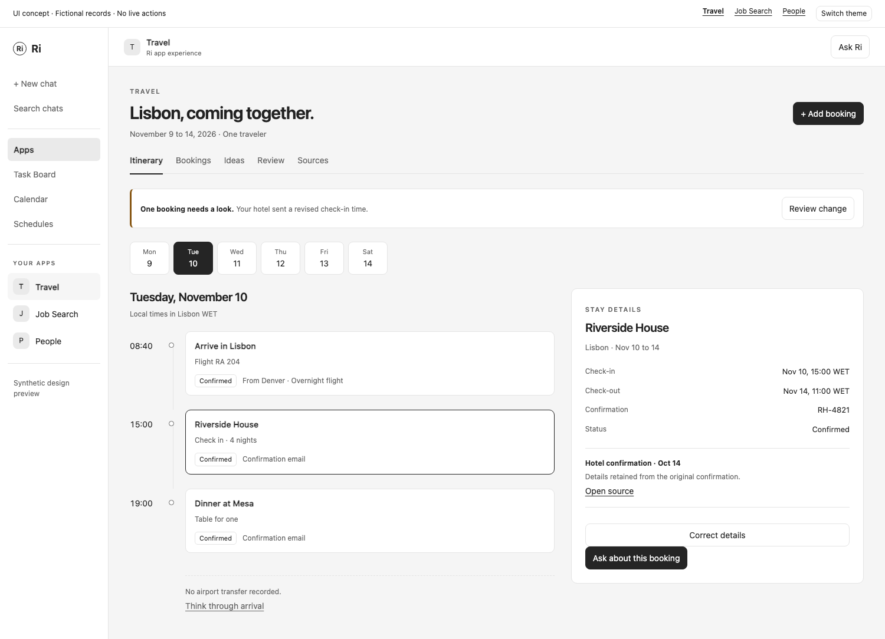

# Travel app specification

October 15, 2026. Proposed implementation scope. Read with the [included apps foundation](included-apps-foundation.md), which defines packaging, permissions, sync, native chat and shared release requirements. Travel can be built and removed independently of Finances, Job Search and People.

Travel turns plans, reservations and changes into a coherent trip that a person can inspect and discuss with Ri. Its first useful moment is opening an upcoming trip and understanding what is booked, what is still an idea and what needs attention.

[Interactive UI concept](mockups/travel-app.html). The concept uses fictional records and illustrates the itinerary, booking inspector, review queue and chat handoff. It is not a running travel integration.



## Product outcome and first release

The first release completes this loop: import a booking, place it in a trip, inspect the itinerary, resolve a change or gap, and carry a concrete follow-up into Ri. Gmail is the first automatic source. Uploaded documents, pasted confirmations and manual items work without an account connection.

Include trips, flight/train/lodging/car/activity records, source documents, change review, a chronological itinerary, saved ideas, comparison of selected options, calendar conflict reads, native chat and explicit Ri follow-ups. Exclude booking execution, cancellations, live fares, live flight operations, shared editing, passport storage and a comprehensive travel marketplace. These remain optional extensions with separate providers and qualification.

## Entry and setup

Display name Travel, package `ri-travel`, suggested route `/apps/travel`, mention `@Travel`. Register trip and booking entity descriptors with deep links based on the installed slug.

The empty screen says "Bring your next trip together" and offers Add booking and Connect email. Add booking accepts a file, pasted confirmation or a small manual form. Connection setup selects an existing or new Gmail account and explains the initial 90-day mail window. An editable history choice supports 30, 90 or 365 days. Always disclose that an older booking may be missing. Preview the first detected trip and sources before enabling ongoing import. Calendar is optional and requested only when the user chooses conflict checks.

Automatically group only unambiguous reservations by traveler, destination and overlapping trip dates. Multiple passengers, forwarded confirmations or overlapping trips go to Review. A booking reference alone is not a globally unique ID. The person can move an item between trips without losing its source or correction history.

## Information architecture

| Surface | Content and primary action |
| --- | --- |
| Trips | Upcoming and past trips. Each row shows destination, dates, recorded reservation count and one useful attention summary. Open trip. |
| Trip | Header with dates and local time context. Itinerary, Bookings and Ideas tabs. Add item and Ask Ri. |
| Review | Unassigned reservations, conflicting changes and extraction fields needing confirmation. Compare evidence, accept, edit, assign or dismiss. |
| Sources | Accounts, calendar selection, imports, coverage, last update and pause/reconnect/delete controls. |

Do not make a setup dashboard the app home. With one upcoming trip, reopen that trip. With several, reopen the last trip or show Trips. The Back control always reaches the trip list. Query state remembers tab, day, selected item and filters without making browser history unusable.

## Main screen concept

At a desktop app width of 1,150 px or more, show the itinerary in about two-thirds of the content area and a selected booking inspector in the remaining space. The day rail is a compact row above the timeline. A selected day scrolls or filters the same ordered itinerary. Each row has time, concise title, location, status and a source indicator.

```text
Travel                                     Add booking   Ask Ri
Trips / Lisbon                Nov 9 to 14, 2026
Itinerary   Bookings   Ideas                 1 item to review

Mon 9   Tue 10   Wed 11   Thu 12   Fri 13   Sat 14

Tuesday 10                       Selected booking
08:40  Arrive in Lisbon           Riverside House
       Flight RA 204              Nov 10 check-in, Nov 14 check-out
       Confirmed                  Confirmation RH-4821
                                  Source: confirmation email
15:00  Riverside House           Observed Oct 14
       Check in, 4 nights         Open source   Correct details

Evening has no plans              Ask about this booking
Add an idea
```

The timeline is the main visualization. It must handle overnight flights, travel days and hotel spans without implying that a multi-day stay occupies every hour. Show departure and arrival local zones on the relevant endpoints, such as Denver MST and Lisbon WET. A hotel stays visible as a date span. All-day items use dates, not midnight timestamps.

Selecting a booking highlights its timeline row and opens source-backed details. Opening Ask Ri uses the native pane. At widths where chat plus inspector would squeeze the itinerary, the inspector becomes a single detail page or closes with selection preserved. Never keep three narrow work columns. On mobile, show the next relevant day, a compact day selector and full-width rows. Booking details use Back.

The Bookings tab is a dense table with type, provider, dates, traveler, status and source. Filters include confirmed, planned, canceled and needs review. The Ideas tab keeps saved places or options visibly unbooked. Select two to four ideas to compare known price/currency, location, check-in conditions and source date. Unknowns say "Not provided". No invented star rating or AI ranking score.

## Important interactions

| Interaction | Required result |
| --- | --- |
| Import confirmation | Preview parsed fields and source. Apply adds or updates the correct booking once and opens its trip. |
| Receive changed flight email | Link the new source to the same booking and show old/new times. An exact provider confirmation may update the itinerary with a visible change record. Conflicting identity or a user-corrected field requires review. |
| Receive cancellation | Mark the booking canceled only with matching reservation evidence. Keep it available in history and show the resulting itinerary gap. |
| Correct a date | Save a user override, retaining the original value. Future ingestion cannot silently overwrite it. |
| "What is missing?" | Stage a question scoped to this trip. Ri can cite missing lodging coverage or conflicting times. Absence of a record is described as "No booking recorded". |
| Add travel task | Preview title and optional due date, then create one linked Ri task. Repeated clicks or retries return the same task. |
| Open directions | Explicitly open the selected address in an external map through the host. No external map is loaded inside the guest. |

MVP gap detection is deterministic for overlapping timed bookings and uncovered nights within explicit trip dates. Mark an uncovered night as a prompt to check, since an overnight journey or staying with friends can be intentional. User dismissal persists until the underlying facts change. Travel-time feasibility needs a qualified route estimate and remains outside MVP.

## Connectors and data inputs

| Input | Initial scope | Dependency and availability |
| --- | --- | --- |
| Gmail | Read selected account, search relevant confirmations, retrieve bodies and explicitly needed attachments, receive changes | Existing actions plus history improvements described in the foundation. No send or mailbox modification scope. |
| Google Calendar | Read chosen calendars for the trip date window | Shared participant/time-zone/pagination work. Calendar conflicts can ship after the email/import loop but before claiming complete MVP. |
| Upload and paste | PDF, text, supported email files and explicit manual entries | Native host transfer and bounded extraction. Scans with no readable text ask for manual fields. Preserve the original document. |
| Outlook | Same read behavior as Gmail and calendar | Subsequent provider qualification, never a cosmetic connect button. |
| Maps and weather | Directions and forecasts | Later provider contracts. A host-opened directions link is enough for MVP. |
| Live flight status | Gates, delays and operating changes | Later dedicated provider. Email freshness is not live flight coverage. |
| Finances and People | Optional spending references and people at a destination | Later scoped public actions. Neither is required or accessed implicitly. |

Search is a relevance filter, not a guarantee that every reservation in the mailbox was found. Sources shows the imported date range and skipped/failed records. Booking attachments are fetched only when needed and within existing host limits. No arbitrary link from an email is fetched with account credentials.

## Domain records and rules

| Record | Required fields and invariants |
| --- | --- |
| Trip | ID, title, destination labels, start/end dates, home zone, state `planning/active/completed/archived`, revision. Manual end dates are inclusive trip dates. |
| Booking | Trip ID, kind, provider, reservation reference when present, traveler references, status `planned/confirmed/canceled`, revision and source links. "Changed" is an event, not a permanent booking status. |
| Segment | Booking ID, sequence, origin/destination, local start/end values, IANA zones when known, resolved instants when known, date-only flag. Missing zones block precise conflict arithmetic. |
| Stay | Booking ID, property/address, check-in date and check-out date, optional times and zone. Check-out is exclusive for lodging-night coverage. |
| Idea | Trip ID, title, user note, optional HTTPS source link, observed price as integer minor units and currency, observed time. Never counted as a confirmed booking. |
| Evidence | Source identity, received/observed time, digest, retained excerpt/file reference, parse version, availability and scope. |
| Change or review item | Subject ID, previous/proposed fields, reason, evidence IDs, decision, revision and durable dismissal. |
| Follow-up link | Subject ID, stable operation ID, Ri task ID, state and last known task availability. |

Do not sum different currencies or treat unknown values as zero. No exchange-rate estimates in MVP. Booking deduplication uses account/source identity first, then provider, reference, traveler and compatible segment dates. Ambiguous matches require review. Reprocessing the same source is idempotent. Sort chronology using instants where known and explicitly marked local/date-only order otherwise.

App actions add `list_trips`, `get_trip`, `save_trip`, `list_bookings`, `get_booking`, `save_booking`, `list_ideas`, `save_idea`, `review_change` and `compare_ideas` to the foundation's common contract. Mutations check revision. Comparisons are reads of saved facts. Every returned booking contains source references and coverage. Context for a trip includes only the selected day/range and authorized bookings, with revisions.

## States and recovery

No trips offers import or manual creation. A trip with only ideas explains that nothing is confirmed. Partial import shows usable records immediately and the remaining count. A reconnect warning preserves the last imported itinerary with its timestamp. A source deleted upstream leaves a source-unavailable marker and does not fabricate a cancellation. Permission revocation follows the foundation's scope and retained-data rules.

Approval waits and first-open busy states use the native host controls. A refresh never repeats an import or discards an edit. If a source cannot be parsed, offer the original document alongside the manual form. Never present a blank failed extraction as an empty trip.

## Implementation sequence and acceptance

1. Package the fixture app with trip, itinerary, inspector, Bookings and Ideas views. Qualify the actual installed view in Ri, native chat handoff, neutral themes and narrow layouts.
2. Implement local records, source provenance, preview/apply import, corrections, chronology and review decisions with fixture files.
3. Qualify Gmail history, bounded background import and one real owner-authorized account. Add calendar conflicts through the shared adapter work.
4. Add linked Ri follow-ups, exports and lifecycle checks. Update README and generated contract with supported inputs and limitations.

Release requires the complete shared checks plus these scenarios:

- An overnight Denver-to-Lisbon journey displays both local dates and sorts correctly. A DST transition and missing zone have explicit expected behavior.
- Four hotel nights, one missing night and an intentional overnight train produce correct coverage with a durable dismissal.
- A confirmation, duplicate, changed confirmation and cancellation retain one booking and inspectable history.
- Two travelers sharing a booking reference and two overlapping trips do not merge incorrectly.
- A manual correction survives reimport. A stale correction fails with a useful comparison.
- Ask Ri cites the selected booking, stages text without sending, and cannot resolve another account's reservation.
- A paused/disconnected app remains readable to its authorized owner, resumes from its checkpoint and can be removed without affecting another app.

Future work can add qualified maps, weather, operating flight updates, trip sharing and approval-backed booking actions. The itinerary must earn its usefulness before those dependencies are introduced.
